# Velocity Atelier

Приватный 3D-шоурум на Nuxt 4, Vue 3, TypeScript и Three.js: осмотр автомобилей, настройка отделки, вход в салон и поездка со звуком двигателя.

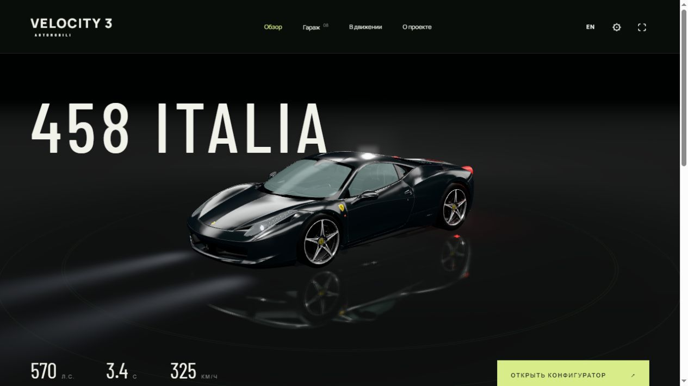

## Текущее состояние

**Автомобили.** Восемь подробных моделей: Lamborghini Revuelto, Porsche 911 GT3 (992.2), Ferrari 458 Italia, Bugatti Tourbillon, McLaren 750S, Aston Martin Valhalla, Mercedes-AMG GT 63 S 4-Door и Koenigsegg Jesko Attack.

**Двери.** Дверь каждой подробной машины поворачивается как жёсткое тело вокруг оси настоящего шарнира, без «парения». Петли, кронштейны с болтами и ограничители построены в Blender (`tools/blender-hinges`), окрашены в чёрное покрытие и подключаются в `app/three/sideDoorConnections.ts`. Родное железо, которое они заменяют (гребёнка ограничителя на дверях Ferrari, белые площадки петель Porsche), убирается при загрузке функцией `removeLooseHardware`:

| Машина | Тип двери | Механизм |
| --- | --- | --- |
| Ferrari 458 Italia | распашная | две чёрные петли на родной оси, кронштейны подогнаны к поверхностям |
| Porsche 911 GT3 | распашная | две тонкие чёрные петли в переднем зазоре, ограничитель с ремнём |
| Lamborghini Revuelto | «ножницы» | родной рычаг и газовый упор, добавлен кронштейн упора на двери |
| Bugatti Tourbillon | вверх-вперёд | ось под крылом, тёмный газовый упор в проёме; при закрытой двери механизм не виден из салона |
| McLaren 750S | диэдральная («крыло») | шарнир скрыт в основании передней стойки (ось поперёк машины с наклоном наружу, `app/three/mclaren.ts`); в проёме виден чёрный газовый упор на кронштейнах (`tools/blender-hinges/build_mclaren_hinges.py` → `mclaren-door-hinges.glb`), при закрытой двери механизм не виден |
| Aston Martin Valhalla | диэдральная («крыло», с половиной крыши) | шарнир скрыт в основании передней стойки; ось — по узлам петли модификации для BeamNG.drive (`app/three/valhalla.ts`), открытие 1,15 рад; в проёме — чёрный газовый упор на кронштейнах (`tools/blender-hinges/build_valhalla_hinges.py` → `valhalla-door-hinges.glb`, точки — `search_valhalla_strut.py`), при закрытой двери скрыт |
| Koenigsegg Jesko Attack | диэдральная synchro-helix (вынос наружу и подъём вверх одновременно) | один поворот на 115° вокруг диагональной оси у основания передней стойки (вперёд, наружу и вниз), найденной перебором осей по столкновениям двери с кузовом на всём пути (`tools/prepare-jesko-model.py`, `app/three/jesko.ts`); открытая дверь стоит вертикально у переднего крыла, обшивкой вперёд. Шарнир скрыт в основании стойки, родной рычаг петли едет в двери, в проёме — чёрный газовый упор (`tools/blender-hinges/build_jesko_hinges.py` → `jesko-door-hinges.glb`, точки крепления — `search_jesko_strut.py`) |
| Mercedes-AMG GT 63 | распашная, открываются только передние двери | ось вертикальная в зазоре у передней кромки двери (у самой обшивки, иначе угол двери задевает крыло), открытие 1,12 рад (`app/three/amg.ts`); задние двери собраны так же, но всегда закрыты; на каждой передней двери две стальные петли и ограничитель с ремнём на окрашенной стойке проёма (стойка с отбортовкой проёма и резиновым уплотнителем, торцы и стойки — сатиновая краска цвета кузова, сайт держит её цвет равным кузову) (`tools/blender-hinges/build_amg_hinges.py` → `amg-door-hinges.glb`), видны только при открытой двери; у карты двери мягкая подсветка, едущая вместе с дверью |

Двери Bugatti были вырезаны из цельной модели по треугольникам, поэтому в обшивке остались трещины (дублированные вершины), дыры и «пила» по кромке, а грубая внутренняя кромка двери местами прорезала окрашенную поверхность — отсюда тёмные рваные пятна в переднем верхнем углу и ступенька внизу у заднего края. `tools/blender-hinges/door_skin.py` сваривает трещины, закрывает дыры и зубцы и убирает кромку на 1,5 мм под обшивку (с подразбиением и плавным изгибом); обрезок карбона, торчавший у замка, удаляется. Кромка рисуется с небольшим смещением глубины, чтобы субмиллиметровые наложения не мерцали.

**Колёса.** Кузов жёсткий и следует высоте, уклону и крену дороги, передние колёса поворачиваются на носителях вместе с суппортами (`app/three/tyreContact.ts`). Колёса крутятся с настоящей скоростью (v/r). Каждое колесо крутится вокруг своей собственной оси (`app/three/wheelAxis.ts`): в моделях Porsche и Bugatti (и у заднего колеса Ferrari) геометрия колеса стояла чуть наискось к своей группе, и при вращении протектор вилял — у заднего колеса Porsche на 12,6 мм, у Bugatti до 6 мм, как будто колесо болтается. Ось и центр находятся по краям протектора (24 сектора: середина между внутренним и внешним краем подгоняется синусоидой — так выглядит наклон, — радиус подгоняется на смещение центра); подгонка не зависит от плотности сетки. После неё биение 1–5 мм (остаток у переднего Porsche — коробление самой шины). На ходу спицы и надписи шины размываются, как на видео (`app/three/wheelBlur.ts`): размываются только спицы между ступицей и ободом — их треугольники при загрузке сливаются в одну лёгкую сетку с запечёнными цветами текстуры и рисуются 12 полупрозрачными копиями одним вызовом (с металличностью и шероховатостью самих спиц и отражениями сцены — матовые копии делали крутящийся серебристый диск почти чёрным); в покое копий нет. Физика поездки считается по реальному прошедшему времени мелкими шагами, поэтому тяжёлый кадр (сразу после перехода на карту, занятая видеокарта) не замедляет машину.

**Карты поездки** (`/drive/<машина>?map=<id>`):

| Карта | id | Модуль | Что на карте |
| --- | --- | --- | --- |
| Тоннель | `tunnel` | `app/three/tunnelRoad.ts`, `tunnelFinish.ts` | облицовочные панели со швами на стенах, торкрет-бетон с копотью на своде, светодиодные светильники направлены на дорогу, асфальт с рельефом |
| Солончак | `desert` | `app/three/saltFlatEnvironment.ts` | оцинкованное ограждение вдоль дороги (`saltFence.ts`: W-балка, двутавровые стойки через 2 м с проставками, световозвращатели, белый солевой налёт у земли); тёплая белая соляная корка по образцу первой версии карты, которая владельцу нравится больше: соль — это сам фотоскан корки (цвет и рельеф), он читается дважды в разных масштабах и под разными углами и смешивается мягкой маской, поэтому плитка 2,4 м нигде не повторяется заметно, а скан с mip-уровнями и анизотропией не рассыпается на пиксели (прежний рельеф по производным экрана давал блоки 2×2 пикселя и убран); едва заметные полигоны, бирюзовые соляные озёра справа; слева на равнине — редкие одиночные маленькие холмики соли (`saltMounds.ts`, 3–5 на участок, не ближе 25 м друг к другу); небольшие лужи нарисованы той же водой, что и озеро (общая функция `brineShade`: те же волны, отражение неба, френель и цвет толщи); под водой — солевое дно (в модели Blender под озёрами дыра, и на мелководье просвечивал серый низ неба); невысокие длинные дальние горы по сторонам — два хребта слева и один справа за озером, впереди вид открыт (`saltHorizon.ts`): острые гребни из ridged-шума, ущелья по склонам, стратовулкан со снежной шапкой, бурый вулканический камень, свет от неба и от белой соли, синеватый воздух и дымка у подножия. Горы, впечатанные в фото-панораму неба (2K, при увеличении выглядели пиксельными), вырезаны из неё ниже 8° (`saltSkyHdr.ts`). Корка соли — скан в полном разрешении 3K, швы полигонов с невысоким валиком и углублённой трещиной (рельеф считается точно), вблизи — мелкое зерно кристаллов; небо — HDR-панорама с облаками |
| Горная долина | `mountain` | `app/three/mountainRoad.ts`, `roadsideScatter.ts` | у подножия скалы вдоль обочины — группы валунов и кустов (камни процедурные, с текстурой скал; расстановка своя для каждого участка, по его рельефу); слева скала со слоями, осыпью, травой и снегом на вершинах, вблизи — мелкая деталь камня; справа склон уходит в море: волны по карте нормалей движутся двумя встречными цугами, бирюзовое мелководье и прибой у берега, туманные полосы без резкой границы |
| Зимний перевал | `winter` | `app/three/mountainRoad.ts` (зимний вариант), `mountainSky.ts` | полная луна над перевалом в просвете долины (моря, кратеры, ореол, облака проходят по ней); едва заметный иней на стёклах машины (`app/three/glassFrost.ts`, стекло остаётся прозрачным), снегопад частицами |

У «Солончака» исторически id `desert`. Прежние карты — Италия, пустыня, побережье, лес и мокрая дорога — удалены вместе с кодом (`motionRoad`, `italianStreet`, `desertRoad`, `coastRoad`, `forestRoad`, `wetRoad` и др.) и моделями (итальянские и римские деревья, брусчатка, HDR улицы Ватикана); всё осталось в истории git.

**Приборы и салон.** У Ferrari и Revuelto свои живые приборы; у Porsche живой щиток (`app/three/porscheInstruments.ts`): нарисованные в текстуре стрелки тахометра и спидометра и цифра скорости стираются один раз, затем стрелки и скорость рисуются в копию текстуры до 30 раз в секунду, но только когда камера в салоне (экраны Ferrari и Revuelto тоже), — снаружи их не видно, а перерисовка и загрузка текстуры стоили кадров; у Bugatti стрелки спидометра (0–550 км/ч) и тахометра на ступице руля вырезаются из модели при загрузке и вращаются при езде (`app/three/tourbillonGauges.ts`). Салоны Bugatti и Porsche подсвечены мягким светом, а очень тёмные цвета обивки слегка «приподнимаются», чтобы кожа читалась (`app/three/upholstery.ts`).

**Конфигуратор.** Покрытие кузова: глянец (металлик), мат или хром — меняется плавно, без пересборки шейдеров (clearcoat и iridescence не доходят до нуля). Цвета кузова, второго цвета, обивки, суппортов, дисков Porsche и цвет окружения меняются плавно (около 1,4 с, смешение в линейном свете), световые схемы тоже перетекают. Двери, стёкла, вход в салон и свет собраны в отдельной вкладке «Двери и свет», а не повторяются под каждой вкладкой; на широком экране панель «прилипает» под шапкой сайта и не уходит под неё при прокрутке. На телефоне панель поездки — одна строка (Авторазгон, Камера, Карта, Ещё), остальное раскрывается по «Ещё».

**Гараж** (`app/pages/garage.vue`) в тёмной палитре сайта, при входе — заставка в стиле загрузки шоурума, пока не загрузится первый ролик (не дольше 6 с); два представления с переключателем «Трейлеры | Фото». Трейлеры (`GarageTrailers.client.vue`): каждая машина на весь экран в ролике, где она едет по карте; у каждой машины четыре ролика — по одному на карту, `public/video/garage/<id>-<карта>.webm` (постер `.webp`, 1920×1080, 60 к/с, рендер в 4K и уменьшение). Кнопки карт переключают ролик (с коротким затуханием) и никуда не уводят; «Поехать» запускает поездку на выбранной карте. Есть кнопка «Звук мотора». Фото (`GaragePhotos.client.vue`): студийные снимки, ракурсы «Спереди / Сбоку / Сзади / Салон» с плавной сменой, `public/garage/<id>-<ракурс>.webp` (2560×1440). В фото — только «Открыть автомобиль» и ракурсы. Фото рендерятся в Blender Cycles на видеокарте из моделей в `blender-cars`: `tools/blender-studio/render_studio.py` (тёмная студия: угольный бесконечный фон, софтбокс, световые полосы, контровой свет; светом линкуется только машина, пол получает свой слабый свет; цвет краски как на сайте; тон-маппинг Khronos PBR Neutral, как на сайте; салон — широкий кадр из-за сидений по центру, у Bugatti — с места водителя), `render_all.sh --photos` (все машины), `publish.mjs` (в `public`). Студийные облёты (`--films`, `encode_film.mjs`) в гараже не используются.

**Фоторежим** (иконка фотоаппарата в шапке и кнопка «Фоторежим» в поездке; `app/components/PhotoStudio.vue`): интерфейс скрывается, сцену можно вращать и приближать, панель справа: объектив 24–85 мм, экспозиция, стиль (натуральный, тёплый, холодный, кино, ч/б, плёнка — цветокоррекция после тон-маппинга), виньетка, глубина резкости (BokehPass с фокусом на машине), кадр (весь экран, 16:9, 2.39:1, 4:5, 1:1 — затемнённые поля, снимок обрезается так же), сетка третей и в поездке «Стоп-кадр» (мир замирает, размытие колёс остаётся). Кнопка-затвор сохраняет PNG прямо из рендера в двойном разрешении экрана (не шире 4K); H — спрятать панель, Esc — выход.

**Номера и ливреи.** На машинах номерные знаки, нарисованные на canvas (`app/three/plates.ts`): итальянский EU-номер на Ferrari и немецкий на Porsche — на бампере, найденном лучом сзади; на Bugatti и Revuelto — на их собственных площадках номера. Ливреи (вкладка «Кузов»: гоночные полосы, полоса Speciale, боковая полоса, шесть цветов) рисуются в шейдере краски в системе координат машины и перенимают покрытие (глянец, мат, хром).

**Дороги.** Общий износ асфальта на всех картах (`app/three/roadWear.ts`): накатанные колеи, масляная полоса, залитые битумом трещины, грязь у кромки; всё сглажено по размеру пикселя (прямоугольные заплатки и пятна по сетке шума читались как «квадраты» и убраны). Асфальт, скалы и снег — в 4K. На солончаке дорога идёт по невысокой насыпи: соль по сторонам на 9 см ниже, обочина плавно спускается к ней. В дождь машина держит дорогу хуже: мягче разгоняется и не выходит на полную скорость, в снег — ещё мягче. Лужи на дороге — органические пятна, а не по сетке. В дождь асфальт темнеет и блестит, в колеях и низинах стоит вода с кругами от капель, за колёсами — водяная пыль (`rain.ts`).

**Панель поездки** прячется кнопкой «Скрыть» (выезжает вниз) и возвращается вкладкой «Панель»; выбор запоминается. Название карты над машиной убрано. **Музыка** — новая панель (`MusicPanel.vue`): что играет, эквалайзер, назад/пауза/вперёд, громкость, режимы «Подряд / Повтор трека», список треков. Музыка не меняется при смене машины: при первом визите выбирается трек под машину на экране, дальше он меняется только по выбору посетителя. **Графика** — кнопки качества с пояснением, лимит FPS с текущим FPS, тени и блики. **Лицензии** переписаны: автомобили, карты, материалы, музыка и звук, программы и шрифты, что сделано для проекта.

**Время суток и дождь** (поездка; `app/three/atmosphere.ts`, `mountainSky.ts`, `rain.ts`): на солончаке и в горной долине — «Время: день / закат / ночь» и «Дождь», на зимнем перевале — «Время: ночь / день» и «Снег / Без снега». Смена времени или погоды идёт под экраном загрузки (сцена прогревается заново, без рывков); фары сами включаются ночью и выключаются днём. Небо для каждого режима (закат с низким солнцем и розовыми облаками, ночь со звёздами, Млечным Путём и полной луной, сплошная облачность в дождь), из него же снимаются отражения машины и воды; свет, туман и экспозиция берутся из таблицы режимов; собственные шейдеры карт (вода, дальние горы, туман над морем) читают общие uniform-переменные; в дождь — косые струи вокруг машины (с учётом скорости), мокрый тёмный асфальт и влажная соль. Ночью фары включаются сами. Днём без дождя карты выглядят как раньше. **Кинокамера** в поездке (кнопка или K): шесть планов со склейками — низкий спереди, проводка у колёс, отъезд сзади вверх, камера у обочины, мимо которой проезжает машина, профиль с длинным фокусом со свободной полосы и вид сверху спереди (`app/three/cinemaCamera.ts`); в тоннеле камера не выше свода и не за стенами, в долине не заходит в скалу. **Страница 404** (`app/error.vue`) — в тёмной палитре с зелёным акцентом. Подсказка «Для плавного просмотра» показывается в браузере один раз.

**Шоурум.** Внизу первого экрана — переход «Другие автомобили — гараж». Обзорный пролёт проигрывается при каждой полной загрузке страницы — один раз для каждой машины (список живёт в состоянии приложения и сбрасывается перезагрузкой); кнопка «Смотреть обзор» запускает его снова. **Отражения машин:** three.js освещает материалы без собственной карты окружения картой сцены с общей силой `scene.environmentIntensity`, игнорируя силу отражений материала, — лак, диски и стекло выглядели одинаково тускло. Машине карта окружения назначается явно (`syncCarEnvironment` в `VehicleScene`), поэтому её материалы снова отражают со своей силой, с небольшим подъёмом на картах.

**Вес моделей** (геометрия Draco, текстуры WebP):

| Машина | Файл в `public/models` | Размер |
| --- | --- | --- |
| Revuelto | `lamborghini-revuelto-web.glb` | 4,5 МБ (исходник 48 МБ) |
| Porsche | `porsche-911-gt3-web.glb` | 2,4 МБ (исходник 11,7 МБ) |
| Bugatti | `bugatti-tourbillon-web.glb` | 3,3 МБ (исходник 15,1 МБ) |
| Ferrari | `ferrari-italia-complete.glb` | 8,5 МБ |
| McLaren | `mclaren-750s-web.glb` | 11 МБ (исходник 60 МБ; 100 материалов вместо 250) |
| Aston Martin | `aston-martin-valhalla-web.glb` | 2 МБ (исходник 11 МБ, масштаб 1:100 приведён к метрам) |
| Koenigsegg | `koenigsegg-jesko-web.glb` | 6,4 МБ (исходник 54 МБ с текстурами высокого разрешения) |

Исходники для повторной сборки лежат в `tools/source-assets/cars` и сайтом не публикуются. У Porsche и Bugatti при сборке (`compress-glb.mjs --detail`) карбон заменяется на сгенерированное переплетение 1024 px, а атласы надписей салона увеличиваются вдвое — в салоне нет «пикселей».

**Запуск без лагов.** Шейдеры прогреваются за загрузочным экраном в том же варианте, в каком рисуется кадр (через постобработку), и компилируются драйвером параллельно; тень фар не включается и не выключается вместе с фарами. Поэтому при первом открытии нет многосекундных замираний после загрузки (раньше у Ferrari до 14 с). Стекло с пропусканием света (transmission) заставляло three.js рисовать машину второй раз в каждом кадре; у всех машин оно заменено обычной прозрачностью (`retireTransmission` в `loadVehicle.ts`) — у Ferrari вызовов отрисовки 846 вместо 1244. При смене машины новая модель прогревается до первого кадра, а старая полностью освобождается.

**Звук.** Двигатели и двери — записи, предоставленные владельцем, плюс CC0/CC BY записи; подробности в [кредитах аудио](public/audio/CREDITS.md). Музыка — Scott Buckley (CC BY 4.0) и собственные темы.

## Запуск разработчику

Рекомендуется Node.js 24 LTS и npm. Версии закреплены в package-lock.json.

```sh
npm ci
npm run dev
```

```sh
npm run typecheck
npm run build
```

Результат — `.output/public`. Это статическое приложение (`ssr: false`), backend и база данных не требуются. Локальный просмотр сборки: `npx serve .output/public`. Хостинг должен обслуживать ресурсы напрямую и возвращать index.html для маршрутов приложения.

## Карта проекта

| Файл | Назначение |
| --- | --- |
| app/pages/index.vue | Шоурум и конфигуратор |
| app/pages/garage.vue, app/components/GarageTrailers.client.vue, GaragePhotos.client.vue | Гараж: трейлеры и студийные фото |
| app/pages/drive/[car].vue | Поездка и выбор карты |
| app/components/VehicleScene.client.vue | Сцена, камера, вход в салон, рендер и освобождение ресурсов |
| app/composables/useAtelier.ts, app/data/vehicles.ts | Общие настройки, список машин и характеристики |
| app/three/loadVehicle.ts | Загрузка четырёх машин и их петель; подготовка Ferrari |
| app/three/revuelto.ts, porsche.ts, tourbillon.ts, mclaren.ts, valhalla.ts, amg.ts, jesko.ts | Материалы, двери, окна и свет Revuelto, Porsche, Bugatti, McLaren, Valhalla, AMG и Jesko |
| app/three/jeskoEngineAudio.ts | Мотор Jesko из звукового мода Koenigsegg Regera (Legacy DMC, GTA V): шесть петель разгона и пять сброса газа на постоянных оборотах (выхлоп и мотор), холостой ход, запуск и глушение; устроен как у McLaren |
| app/three/amgEngineAudio.ts | Мотор AMG GT 63 S (M177 4.0 V8 битурбо) из звукового пакета «Mercedes-AMG 4.0T V8 (M17x) Engine Sound Pack» (GTA V): шесть петель разгона и четыре сброса газа на постоянных оборотах, холостой ход, запуск и глушение; устроен как у Jesko |
| app/three/amgInstruments.ts, jeskoInstruments.ts | Живые щитки AMG (стрелки и цифры) и Jesko (кольцо оборотов, скорость и передача на экране руля) |
| app/three/sideDoorConnections.ts, revueltoDoorMotion.ts | Оси дверей, петли, ограничители и газовые упоры |
| app/three/instruments.ts | Приборы |
| app/three/vehicleLamps.ts, porscheLamps.ts | Фары и задние фонари |
| app/three/tunnelRoad.ts, saltFlatEnvironment.ts, mountainRoad.ts | Карты поездки |
| app/three/straightMotion.ts | Движение и трансмиссия |
| app/three/*EngineAudio.ts, doorAudio.ts | Двигатели и двери |
| public/models, public/audio, public/textures | Ресурсы, которые загружает браузер |
| tools/source-assets | Редактируемые исходники моделей и звука, не публикуются |

В app/three и tools сохранены ранние эксперименты: около тридцати модулей app/three (например desertRoad, coastRoad, forestRoad, wetRoad, scannedRoad, cabin) не импортируются текущей сценой и в сборку не попадают. legacy-assets — архив прежних моделей, docs/screenshots — снимки прежних этапов.

## Инструменты моделей и звука

Blender 5.2 запускается без интерфейса:

```sh
blender --background --python tools/blender-hinges/<скрипт>.py -- <путь к checkout> [аргументы]
```

| Инструмент | Что делает |
| --- | --- |
| `tools/blender-hinges/build_{ferrari,porsche,revuelto,bugatti}_hinges.py` | Строят `public/models/*-door-hinges.glb`: петли, кронштейны, болты, ограничители и упоры. Площадки кронштейнов подгоняются к поверхности лучами (`hingekit.py`), проверяются проникновение и столкновения во всех положениях двери |
| `tools/blender-hinges/clean_bugatti_doors.py` | Исправляет разделение дверей Bugatti: возвращает куски кузова, ездившие с дверью, и наоборот, срезает рваную «пилу» и висящие полоски обшивки у стойки, листы впереди линии двери, невидимые при закрытой двери, затем чинит обшивку и кромку (`door_skin.py`) и убирает обрезок карбона у замка. `preview` — проверочные рендеры, `export <out.glb>` — модель для сжатия |
| `tools/blender-hinges/door_skin.py` | Ремонт панелей, вырезанных из цельной модели: сварка трещин, закрытие дыр и зубцов кромки (новые грани наследуют UV и нормали соседей), заправка грубой кромки под обшивку |
| `tools/blender-hinges/export_blend.py` | Сохраняет `.blend` машины с петлями и анимацией дверей: кадры 1–60 открытие, до 100 открыто, 101–150 закрытие. Двери висят на пустышках «Hinge axis …», упоры наведены Damped Track. Машины: ferrari, porsche, revuelto, bugatti, mclaren, valhalla, amg (у AMG — четыре двери с петлями и ограничителями, номер сайта на номерных площадках, кожа салона в цвете обивки сайта по умолчанию; McLaren: `mclaren-750s-rigged.glb` + `mclaren-door-hinges.glb` → `blender-cars/mclaren.blend`) |
| `tools/blender-live.mjs`, `tools/blender-hinges/live_shot.py` | Работа в открытом Blender через дополнение Blender MCP (localhost:9876) и снимок вьюпорта |
| `tools/compress-glb.mjs` | Сжатие GLB для сайта: Draco и WebP, материалы не объединяются (код ищет их по имени). С `--detail` — чёткие текстуры салона (`upgrade-car-textures.mjs`); с `--lossless=<regex>` подходящие по имени текстуры (экраны, атласы значков) идут WebP без потерь |
| `tools/amg-hd-textures.mjs` | Текстуры салона AMG высокого разрешения: кожа, отделка дверей и микрофибра нарисованы заново 2048 px с картами рельефа (normal map), игровые атласы значков и вставки дверей донора увеличены в 2–4 раза с гладкими контурами (`amg-hd/`); `prepare-amg-model.py` подставляет их по имени. Запуск: `node tools/amg-hd-textures.mjs` |
| `tools/prepare-mclaren-model.py` | McLaren 750S из игровой модели: поворот к осям сайта, четыре колеса и две диэдральные двери из разрозненных деталей, объединение одинаковых материалов и деталей; чистка скрытых зон под дверью: детали внутри двери уходят в дверь, отделка стоек и уплотнители проёма, лежащие на кузове, остаются на кузове, торчащие за контур двери полосы и задние стороны листов на пороге убираются, порог в одном тёмном материале. Запуск на исходной модели: `blender -b blender-cars/backups/mclaren-original.blend --python tools/prepare-mclaren-model.py -- out.glb [rigged.blend]`, затем `compress-glb.mjs`; готовая сборка лежит в `blender-cars/mclaren.blend` |
| `tools/prepare-valhalla-model.py` | Aston Martin Valhalla: масштаб 1:100 → метры, поворот к осям сайта, четыре колеса на своих осях с заводским развалом 1,5° спереди и 1,0° сзади (сайт не подгоняет их заново), суппорты неподвижны, двери из целых деталей по списку `tools/source-assets/cars/valhalla-door-pieces.json`, раздельный свет фар и фонарей. Чистка скрытого: петли ворса у порога и низа двери, иглы-треугольники, детали угла петли, что прорезали крыло при открытии, тёмный карман петли и тёмная подкладка внутри обшивки двери; торцы и низ двери заменены собранными торцами двери модификации (`tools/extract-valhalla-door-ends.py` → `valhalla-door-ends.glb`); проёмы дверей (порог с каналом уплотнителя, стойки) заменены проёмами кузова модификации там, где их закрывает дверь (`tools/extract-valhalla-apertures.py` → `valhalla-apertures.glb`, в карбоне модели); острые висящие треугольники стоек и порога проёма, которых не видно при закрытой двери, убраны; карман, торцы, подкладка и загнутые кромки обшивки — матовые чёрные без бликов; за всеми щелями, решётками и прорезями до ~5 см стоит тёмная подложка (воксели 12 мм, только видимые сквозь щели участки), у кузова и у каждой двери своя; почти непрозрачные детали (решётка, значки, прорези, отделка, внутренности фонарей) выгружаются непрозрачными. Запуск: `blender -b blender-cars/backups/valhalla-original.blend --python tools/prepare-valhalla-model.py -- out.glb [rigged.blend]`, затем `compress-glb.mjs` |
| `tools/prepare-amg-model.py` | Mercedes-AMG GT 63 S 4-Door (mohamedouartassi): модификаторы применены (сглаживание на уровень легче, чем во вьюпорте, шины упрощены), масштаб в метрах (длина 5,054 м) и поворот к осям сайта, четыре колеса (суппорты неподвижны), четыре двери на петлях у передних кромок со стёклами, хромом и зеркалами. Салон модели — заготовка: он заменён салоном Mercedes-AMG E 63 S (W213) из `amg-interior.glb` (та же платформа: база, вырезы дверей и пол совпадают), вписанным под крышу и стёкла AMG (выше пояса всё поджато к центру, пока потолок и стойки не отойдут от крыши, стёкол и стоек AMG на 12 мм), с удалением всего, что вышло наружу кузова; детали обшивки E 63 (панель, накладки, подлокотник, ручка, кнопки, динамик, полоса подсветки) отданы дверям, рамки стёкол срезаны по поясу (у AMG безрамочные двери). Основа обшивки донора (её края — «пила» полутреугольников, донор никогда не открывал двери) пересобрана: лицевая поверхность снята лучами по сетке 8 мм, доведена до контура двери AMG (непокрытое заполнено гармонически), сглажена, держится за декоративными деталями и в 2 см от кузова, уложена ровной сеткой 12 мм в её материале; декоративные детали подрезаны плоскостями у кромок двери и у кузова; панель обтянута зернистой отделкой (`amg-cabin-grain.png`), торец по всему контуру — окрашенный в цвет кузова с резиновым уплотнителем у края обшивки, подоконник до верхней кромки кузова в той же отделке и сглажен вдоль двери; низ обшивки достроен: круглый динамик Burmester с решёткой (`amg-cabin-grille.png`) и ободком спереди внизу, карман под подлокотником, плавно выходящий из панели, полоса ковролина по низу; тонкие кромки карманов, лежавшие вплотную к основе, убраны; в кузове — окрашенные стойки проёмов под петли. Чисто-чёрные пластики донора (#000, на сайте читались как дыры) — тёмный графит. Без бликов: материалы салона матовые (глянцево-чёрное 0,45, карбон 0,5, хром — тёмный шлифованный алюминий), нетекстурированные светло-серые детали донора — тёмные, у салонного зеркала тёмное стекло, хромовая вставка порогов — сатиновый алюминий. Экраны, карбон и ткань нарисованы для проекта (`amg-cabin-cluster.png` — приборы AMG 2048×1024 в раскладке донора, `amg-cabin-media.png` — экран мультимедиа с картой, маршрутом, музыкой и меню на правой половине панели вместо россыпи значков, `amg-cabin-carbon.png` — саржа 1024 px вместо плитки 128 px, `amg-cabin-fabric.png` — ровная микрофибра вместо пятнистой ткани донора на торпеде, полу, стойках и хватах руля); повторы одних и тех же текстур донора под разными именами сведены в один материал на семейство (кожа вставок дверей = кожа сидений и берёт цвет обивки; ткань; карбон). Обод руля пересобран гладкой трубкой на том же кольце (плоскость и центр подогнаны по ободу, радиус по углу каждые 2°, сечение 39×40 мм, 180×24 четырёхугольника, кожа по бокам, микрофибра сверху и снизу, карбоновая метка на 12 часах); подушка и ступица руля — два уровня подразделения (были гранёными), спицы — сглаженное затенение по углу; хромовое кольцо контроллера на консоли пересобрано (96 сегментов, скруглённые кромки, по тому же кругу), красный треугольник аварийки (был наполовину утоплен в кнопку) — ровный светящийся контур. Широкий экран — одно стекло: игровая приборка донора (картинка занимала лишь середину её высоты, вокруг — чёрная рамка) убрана, приборы и мультимедиа — два экрана одной высоты (27,8 и 30 × 9 см) на общем тёмном стекле с узкой перемычкой. Торец двери со стороны петель строится по контуру без «лоскутов» (глубина до обшивки берётся у соседей там, где луч промахивается, и сглаживается по контуру); салон закрыт по всему кузову: изнутри кузов был голой обшивкой — везде, где её обратная сторона видна с сидений, снаружи сквозь стёкла или из проёма открытой двери (проверка лучами), она подбита тёмной обшивкой (сверху — микрофиброй потолка), включая перевёрнутые в исходной модели грани; добавлены полка багажника за задними сиденьями (у лифтбэка там был пустой багажник), алюминиевые накладки порогов от пола до кузова (там была дыра до земли), щитки ног у передних стоек; все материалы двусторонние (материалы салона W213 из игры были односторонними — на сайте детали «сзади» были дырами), краска кузова на сайте тоже двусторонняя; стёкла дверей изогнуты по дуге через щель подоконника и опускаются поворотом вокруг её центра — внутрь двери между обивкой и обшивкой (раньше опускались прямо и выходили в салон сквозь обивку); по внутреннему контуру двери — резиновый уплотнитель (трубка 13 мм), полоса панели между вставкой W213 и передней кромкой двери закрыта кожаной накладкой, подоконник — кожаный валик с плоским верхом и резиновым уплотнителем щели стекла, обрезан точно по длине двери (раньше выходил за переднюю кромку «полкой»); экраны на сайте читаются на мип-уровень резче (LOD bias −1); у кармана двери — кромка из сатинового алюминия и тонкая полоса подсветки, у динамика — алюминиевое кольцо, отделка низа двери — тёмный графит. Приборы и экран мультимедиа перерисованы подробнее и по-русски крупным шрифтом, читаемым с места водителя (стрелки со свечением, данные двигателя, режим S+; карта в перспективе с объёмными домами, парком, манёвром и временем прибытия, музыка, климат, меню), 4096 px, на сайте без сжатия с потерями. Все текстуры салона, видимые вблизи, не меньше 2048 px (`tools/amg-hd-textures.mjs`): кожа, отделка дверей и микрофибра с картами рельефа. Серебряные спицы руля сварены и подразделены, обод руля сглажен по радиусу, осколки старого обода вокруг него убраны. Сборка для сайта: `compress-glb.mjs … --detail "--lossless=amg-cabin-(cluster|media)|Meshessalon0111|Meshessalon1_|Meshestr0021"`. На сайте у текстур салона анизотропная фильтрация (не размываются под углом). Шины и поворотники — простые поверхности вместо процедурной «пыли» автора, надписи номера автора убраны. Запуск: `blender -b --disable-autoexec blender-cars/backups/amg-original.blend --python tools/prepare-amg-model.py -- out.glb [rigged.blend]`, затем `compress-glb.mjs`; `amg-plate.png` — номер сайта для Blender-сцены (`export_blend.py amg`) |
| `tools/prepare-jesko-model.py` | Koenigsegg Jesko Attack (Ddiaz Design, игровая модель Racing Master): масштаб 1:100 → метры, поворот к осям сайта, четыре колеса на своих осях, две двери на диагональной оси, удалена проушина игровой петли на стойке, фары/фонари/повторители разделены, единая кожа под цвет обивки, матовый салон и сатиновый алюминий, подкладка там, где из салона видна изнанка краски крыши, текстуры высокого разрешения подставляются по имени. Запуск: `blender -b --disable-autoexec blender-cars/backups/jesko-original.blend --python tools/prepare-jesko-model.py -- tools/source-assets/cars/koenigsegg-jesko-rigged.glb` |
| `tools/pack-jesko-audio.py` | Звук Jesko из мода Regera (Legacy DMC; контейнер AWC в `tools/source-assets/audio/jesko-regera-mod` читается напрямую): тон двигателя отслеживается в разгоне и сбросе газа (скачки октавы исправляются), окна вокруг нужных оборотов перевыбираются по времени так, чтобы тон стоял на месте, выхлоп и мотор смешиваются, петли без шва; холостой ход, запуск и глушение. Без потерь (FLAC). Запуск: `blender -b --factory-startup --python tools/pack-jesko-audio.py` |
| `tools/pack-amg-audio.py` | Звук AMG GT 63 S из ресурса M177 (контейнер AWC в `tools/source-assets/audio/amg-m177-mod`): как у Jesko, но обороты отслеживаются по одной непрерывной гармонике (порядок 1,5, об/мин = 40 × Гц), выхлоп при сбросе газа выравнивается по времени с мотором. Запуск: `blender -b --factory-startup --python tools/pack-amg-audio.py` |
| `tools/jesko-hd-textures.mjs` | Текстуры Jesko высокого разрешения из исходных игровых (`tools/source-assets/cars/jesko-textures` → `jesko-hd`): карбон-твил 2048 px с картой рельефа, атласы салона, надписей, значков, фар, шин и тормозов ×4. Экраны (4096 px) и надписи на шинах рисуются отдельно в браузере (холст) поверх этих файлов |
| `tools/extract-amg-interior.py` | Салон для AMG из «Mercedes-AMG E 63 S (W213)» (Mona x Supercars, CC BY): всё внутри короба салона без краски, стёкол, фонарей, колёс, шин и бампера (основы обшивки дверей помечены — их пересобирает prepare-amg-model.py, тонкие кромки карманов убраны), семейства повторяющихся текстур сведены в один материал, в метрах и осях AMG (оси колёс совмещены), детали дверей помечены, текстура кожи осветлена до светлой выделки (цвет обивки из конфигуратора умножается на неё). Запуск: `blender -b --python tools/extract-amg-interior.py -- <scene.gltf донора> tools/source-assets/cars/amg-interior.glb` |
| `tools/match-valhalla-doors.py`, `tools/extract-collada-parts.cjs` | Список деталей дверей Valhalla: сверка с дверями и кузовом модификации Aston Martin Valhalla для BeamNG.drive (S7471C; сам мод на сайт не попадает) |
| `tools/pack-valhalla-audio.cjs` | Звук Valhalla: петли двигателя и выхлопа из модификации для BeamNG.drive (M840T, разгон и накат, шаг ~400 об/мин) без изменений в четыре банка, холостой ход — смесь двух; таблица петель — в `app/three/valhallaEngineAudio.ts`, FLAC — `compress-engine-audio.py` |
| `tools/bake-revuelto-web.mjs` | Веб-версия Revuelto: маски старых крюков и сжатие |
| `tools/prepare-bugatti-user-continuation.py` | Звук Bugatti: петли разгона и наката, восстановление срезанных пиков, общий запас −1 dBFS. Запуск Python с numpy, например из Blender |

Рендеры проверки пишутся в папку из переменной `HINGE_OUT` (по умолчанию `tools/blender-hinges/out`, в git не попадает). Какой исходник в какую модель сайта превращается — `tools/source-assets/cars/README.md`.

## Добавление автомобиля

1. Получить модель и записать происхождение, автора и лицензию.
2. Настроить масштаб, ориентацию, положение на полу и группы материалов.
3. Разделить двери/окна и вращающиеся колёса/неподвижные суппорты; проверить оси вращения.
4. Подключить загрузчик и характеристики. Имена узлов Ferrari не переносить автоматически на другие модели.
5. Настроить отделку, фары, приборы, камеры и подходящие аудиозаписи.
6. Выполнить typecheck и сборку, визуально проверить зазоры, окна, двери, салон и движение. Проверить производительность и освобождение GPU/аудиоресурсов при смене страницы.

## GitHub и Vercel

Репозиторий остаётся **Private**. На Vercel включена Vercel Authentication → All Deployments: все адреса требуют входа и прав доступа. До отдельного решения владельца не отключать Deployment Protection. Автоматические Git-деплои пока отключены в vercel.json; новые версии запускаются вручную из панели Deployments.

Сборка: npm run build; выходной каталог: .output/public. Локальная привязка .vercel и секреты исключены из Git. Собственной авторизации в приложении нет: закрытый доступ обеспечивает хостинг.

## Ресурсы

Модели: Lamborghini Revuelto — Anatolian Studios; Porsche 911 GT3 992.2, Ferrari 458 Italia и Bugatti Tourbillon — Ddiaz Design; McLaren 750S — geyges; Aston Martin Valhalla — Ddiaz Design (двери — по модификации S7471C для BeamNG.drive); Mercedes-AMG GT 63 — mohamedouartassi, салон — Mercedes-AMG E 63 S (W213) от Mona x Supercars (обе CC BY 4.0); Koenigsegg Jesko Attack — Ddiaz Design (CC BY-NC-SA 4.0) (Sketchfab Free Standard). Геометрия и текстуры сохранены, добавлены подготовка дверей, колёс и материалов и петли дверей. [Происхождение и лицензии моделей](public/models/CREDITS.md).

Дорожные текстуры — Poly Haven. Записи двигателя и дверей предоставлены владельцем. [Кредиты текстур](public/textures/CREDITS.md), [кредиты аудио](public/audio/CREDITS.md). Лицензии ресурсов различаются; перед публичным или коммерческим запуском необходимо подтвердить права на исходные ресурсы. Общая лицензия на весь проект не заявлена.

Для работы сайта готовые ресурсы уже находятся в public. Исходники четырёх машин для повторной подготовки — в `tools/source-assets/cars`; прежние донорские модели могут потребовать отдельного получения.

Репозиторий: https://github.com/Sait5/velocity-atelier
Панель Vercel: https://vercel.com/saits-projects-f4e494ad/velocity-atelier


Закрытый сайт: https://velocity-atelier-saits-projects-f4e494ad.vercel.app/

## История разработки

Ниже — журнал прежних этапов в порядке работы; каждый раздел описывает состояние на тот момент. Актуальное состояние — в начале файла.

### Первый этап: Ferrari 458 Italia

Приватный 3D-шоурум на Nuxt 4, Vue 3, TypeScript и Three.js. Первый этап — Ferrari 458 Italia: осмотр, настройка отделки, салон и движение со звуком двигателя.


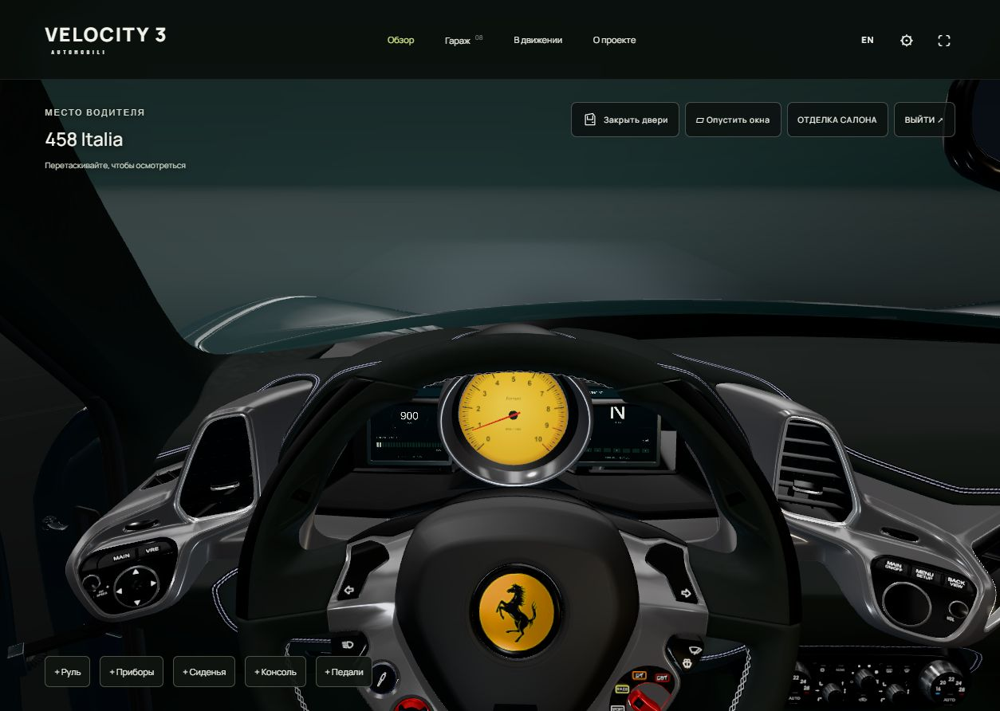

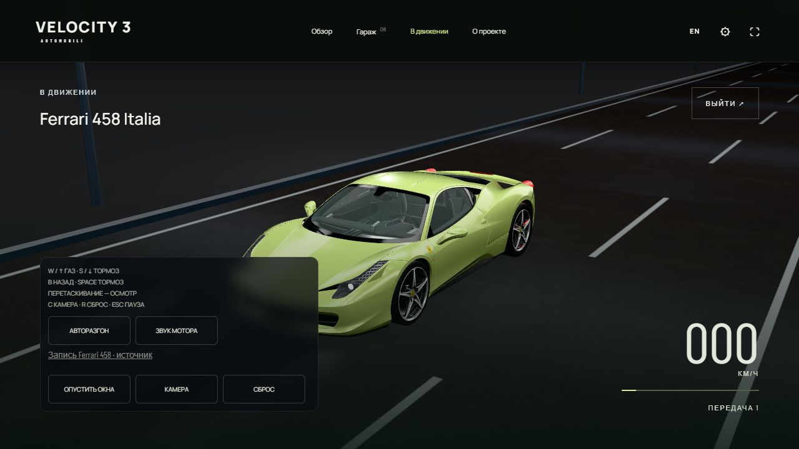


В движении доступны две карты: **«Тоннель»** (judefelix, прямая повторяющаяся дорога) и **«Скалистое побережье»** (новая карта Velocity Atelier, 3 км). Выбор через кнопку «Сменить карту», без фотографий. Прямой вход на побережье: `/drive/revuelto/?map=coast`. Повороты выполняются автоматически по новой плавной траектории. Объёмный склон справа, скалистый обрыв и море слева, дорожные материалы и камень PBR, умеренная растительность. Старый скан Metazeon удалён из runtime. Ресурсы предыдущей карты освобождаются при переключении.

Подготовка тоннеля: Blender с `tools/prepare-tunnel.py`, затем `node tools/prepare-tunnel.mjs`. Источник и лицензия: `public/models/CREDITS.md`.

Детализированная Ferrari, открывающиеся двери, поднимающиеся боковые окна, плавный вход в салон, приборная панель, переключаемые фары, отражения и свет на полу. Цвет кузова и обивки сохраняется через localStorage. Есть ночная дорога, семь передач, газ, тормоз, задний ход и максимальная скорость 325 км/ч. Внешний звук двигателя отличается от записи в салоне; добавлены звуки дверей, торможения и музыка.

Это визуальный режим движения, а не гоночный симулятор. Для производительности используются адаптивное разрешение, ограниченная частота обновления звука/приборов, оптимизация теней и вращающихся дисков.

В гараже восемь машин: подробные Ferrari 458 Italia и Lamborghini Revuelto, остальные шесть — черновые модели будущей коллекции. Ferrari 458 занимает место прежней карточки Ferrari 296 GTB.

В поездке кнопки расположены в две колонки; для Ferrari и Revuelto доступны боковые окна. Диалог «Сменить карту» предлагает итальянскую улицу и ночную дорогу с фонарями. Выбор сохраняется в состоянии текущей сессии отдельно для каждого автомобиля. При смене карты модель и отделка сохраняются, движение сбрасывается, освобождаются ресурсы старого окружения. Экран загрузки закрывает сцену до загрузки карт, текстур, компиляции шейдеров и первого кадра; затем плавно исчезает. У Revuelto отдельный предел демонстрационного движения 370 км/ч; справочное значение каталога остаётся «350+». Предел Ferrari — 325 км/ч.

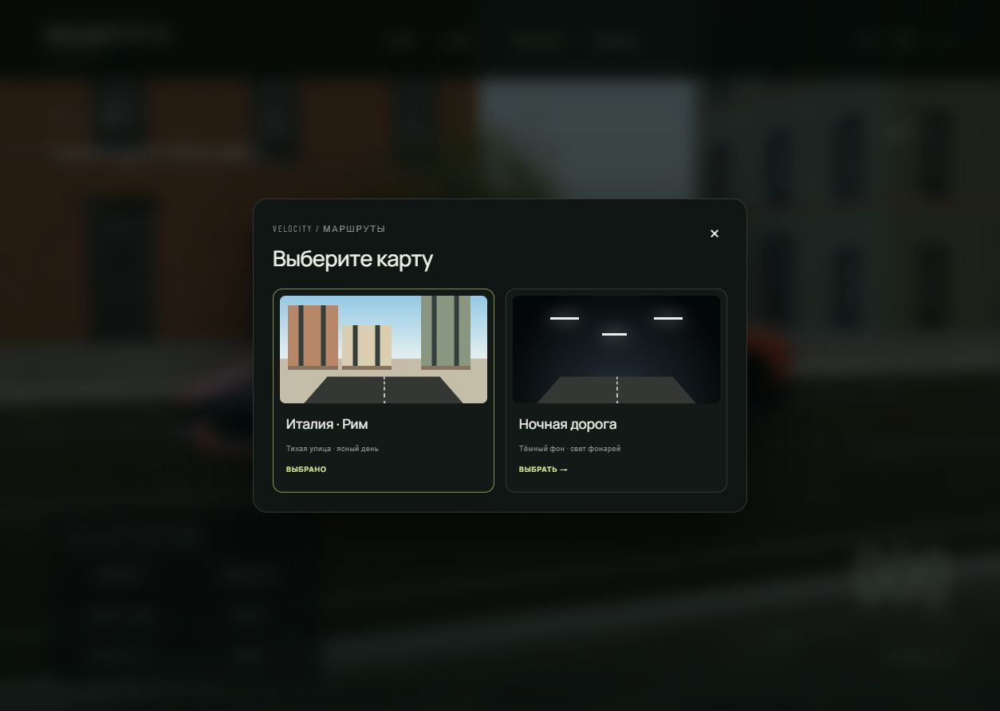

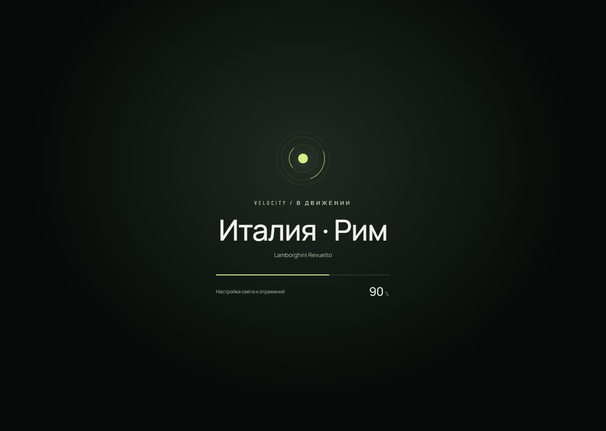

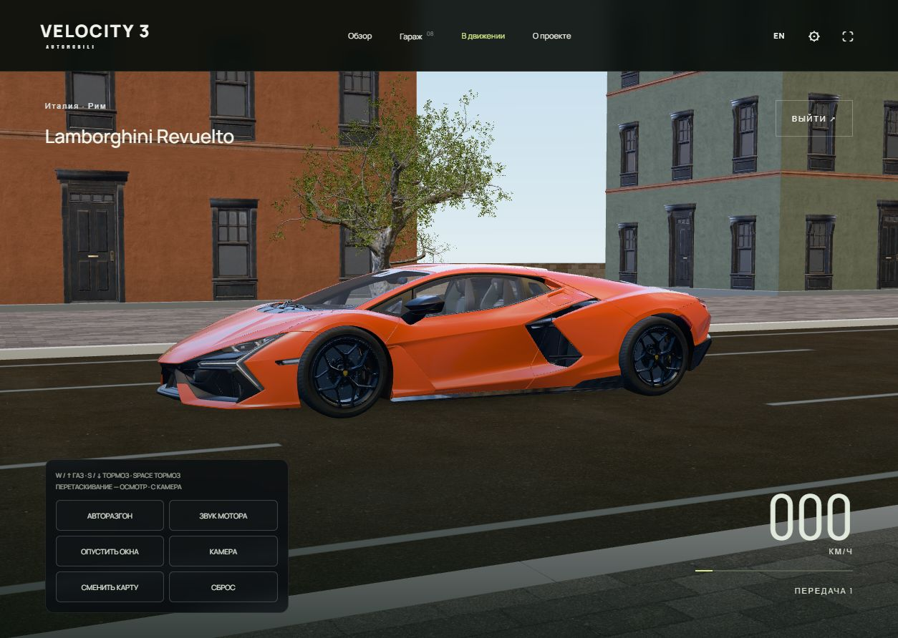

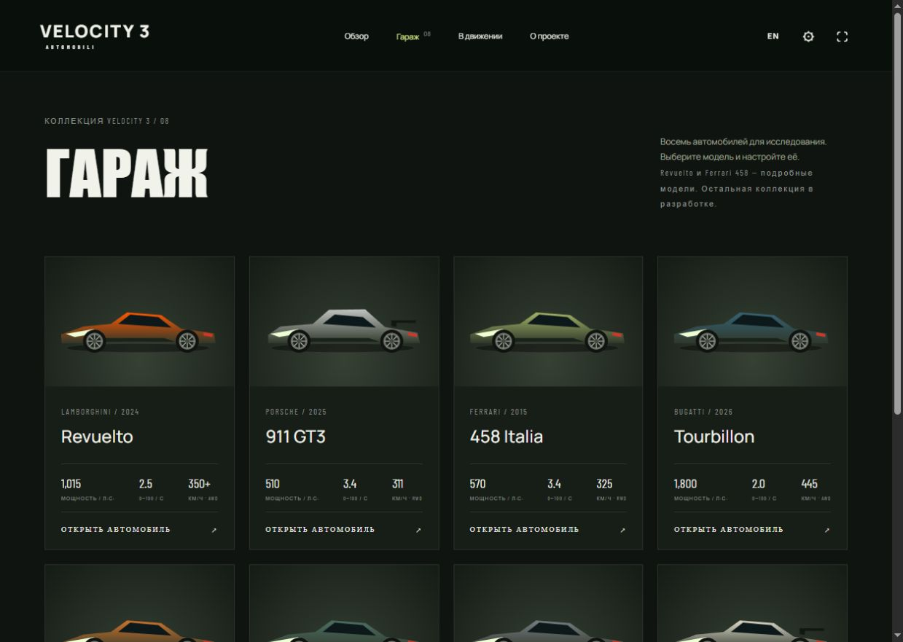

### Свет, дорога и настройки графики — октябрь 2026

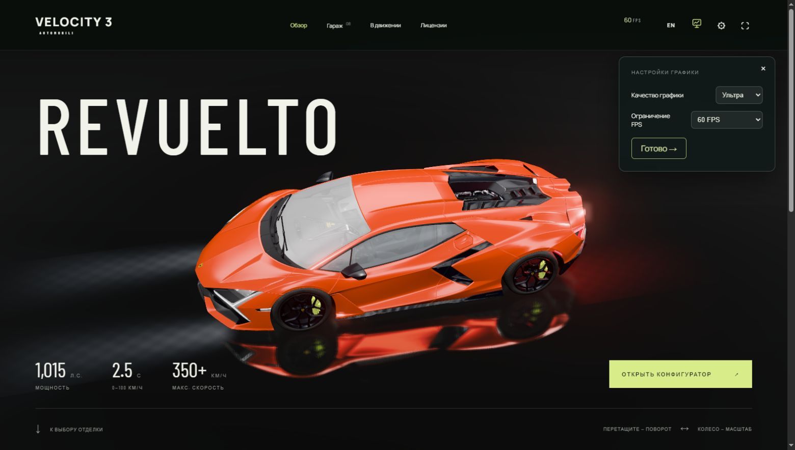

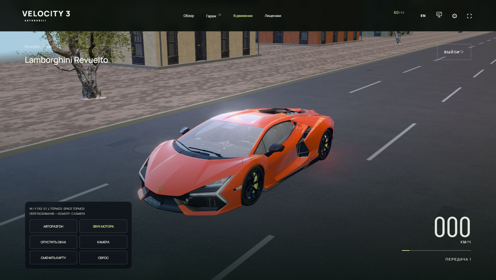

Передние фары используют emissive-геометрию и короткие SpotLight с мягким краем пучка. Задняя оптика использует emissive и локальные красные источники. На высоком и ультра качестве добавлен Bloom; один передний источник получает динамические тени с картой 512×512. Среднее качество сохраняет освещение поверхности, отключая дорогие эффекты.

Асфальт переведён на MeshStandardMaterial: текстуры цвета, нормалей и шероховатости участвуют в настоящем освещении Three.js. Свет фар и ночных фонарей меняется по мере движения. Положение студийного света и environment map создают движущиеся блики на кузове; отражатель пола зависит от камеры. Это растровый PBR и контролируемая имитация, без SSR и path tracing. В движении плоские накладки свечения скрыты: поверхность освещается источниками сцены.

Одна цельная геометрия асфальта, одинаковый материал на всей длине. С каждой стороны единая плоскость мощения продолжается от дороги под здания до их заднего края; прежние соседние платформы разных высот и белая полоса на стыке удалены. Дорожная разметка остаётся самостоятельной частью дизайна.

Для смены карт используются общий пул исходных моделей и текстур, предварительная загрузка итальянских ресурсов и прогрев шейдеров. Экземпляры предыдущей карты и их отдельные материалы освобождаются; общие исходники используются повторно и освобождаются при выходе из поездки. Во время подготовки карты основной цикл рендера приостановлен за экраном загрузки, загрузка GPU-текстур распределена по кадрам. Первое открытие всё ещё зависит от сети и скорости устройства.

Счётчика FPS в шапке больше нет (по решению владельца); в шапке доступны «Лицензии» и настройки графики с иконкой монитора. В основных настройках оставлена ссылка на раздел графики вместо второго выбора качества. После готовности сцены появляется небольшое закрываемое предупреждение о снижении качества и ограничении FPS. Локально проверены 30 FPS на среднем качестве, Ferrari и Revuelto, смена карт, отсутствие ошибок компиляции дорожного шейдера.

Проверки сцены:

```sh
node tools/verify-light-road.mjs
node tools/verify-drive.mjs
node tools/verify-intro.mjs
npm run typecheck
npm run build
```

`verify-light-road.mjs` проверяет цельную поверхность, совместимость вставки в PBR-шейдер, повторное использование исходников без изменения донорских материалов, освобождение экземпляров трёх смен карты и ограничение количества теней фар.

### Доработка окружения и света на поверхности

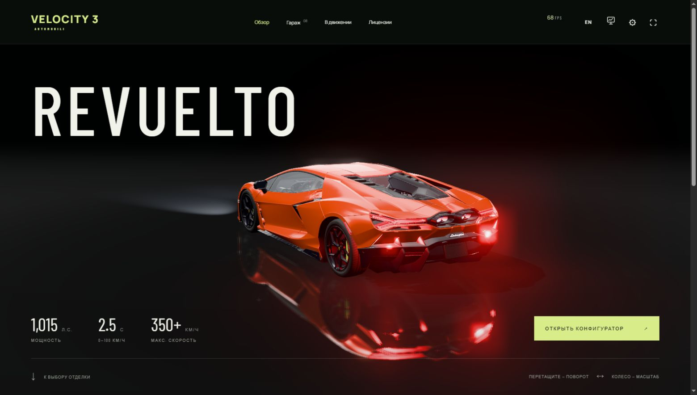

Материал и цвет студийного пола сохранены; цвет меняется только через выбор окружения. Реальные передние прожекторы дают более широкий мягкий пучок, красные источники сзади освещают поверхность заметнее. Отсвет на прежнем полу студии рассчитывается в мировых координатах: направление прожектора, обратный квадрат расстояния, GGX/Schlick и положение камеры определяют яркость и форму блика. Границы полностью растушёваны, статичный рисованный узор удалён; в поездке используются реальные источники на PBR-покрытии. Изменения применены к Ferrari и Revuelto.

Асфальт использует MeshPhysicalMaterial с небольшим отражающим слоем, нормалями, шероховатостью и неброскими следами износа. На ночной карте появились отражатели вдоль дороги, люки и решётки; тёплые и холодные фонари создают меняющиеся световые пятна при движении. Количество локальных дорожных источников осталось прежним — два.

Деревья расставлены устойчивыми нерегулярными группами по 3–6 на участок, с разными масштабом, поворотом, шириной кроны и оттенками. Используется общая исходная геометрия через InstancedMesh. Детали кладки на цоколях и трубах нарисованы в материале без дополнительных текстур. Окна фасадов остаются непрозрачными, с высокой шероховатостью и слабым environment-отражением, без отдельных отражающих камер.

Переключатели «Вращение света» и «Сетка студии» сгруппированы в окружении. Вращение освещения не зависит от переключателя анимации камеры. Тест окружения дополнительно проверяет плотность посадок, стабильность при повторном появлении участка и безопасное расстояние между деревьями.

### Lamborghini Revuelto — этап модели

Подключена модель Anatolian Studios (CC BY 4.0), выбранная владельцем. Прямой вход: `/?car=revuelto#showroom`. Сохранены исходные салон, кузов, текстуры и геометрия; добавлены группы дверей с подъёмом вверх, опускание основных боковых стёкол, оси вращения колёс и неподвижные суппорты. Адаптер: `app/three/revuelto.ts`. Звуки двигателя и окончательный свет для Revuelto — следующий этап; текущий режим движения использует временный синтезированный звук. Записи Ferrari на Revuelto не используются.

#### Revuelto: cabin and music refinement
Door assemblies include inner painted shells, edge seals and latches; the two-phase opening first releases the door outward before lifting. A vehicle-specific driver anchor is used in showroom and drive. Five original instrumental themes are selectable in Settings, including the existing Atelier Ambient; Auto chooses Night Pulse for Revuelto. Theme choice is saved, track changes crossfade, and hidden tabs pause audio. Revuelto uses a darker studio floor and shorter background fog.

#### Проверенный вид Revuelto

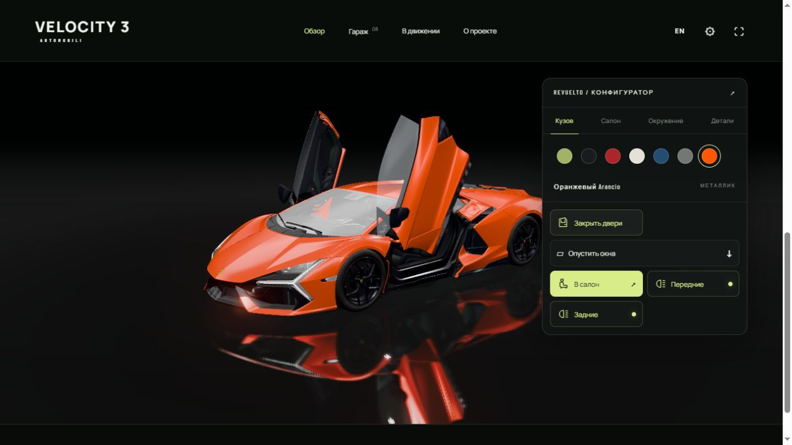

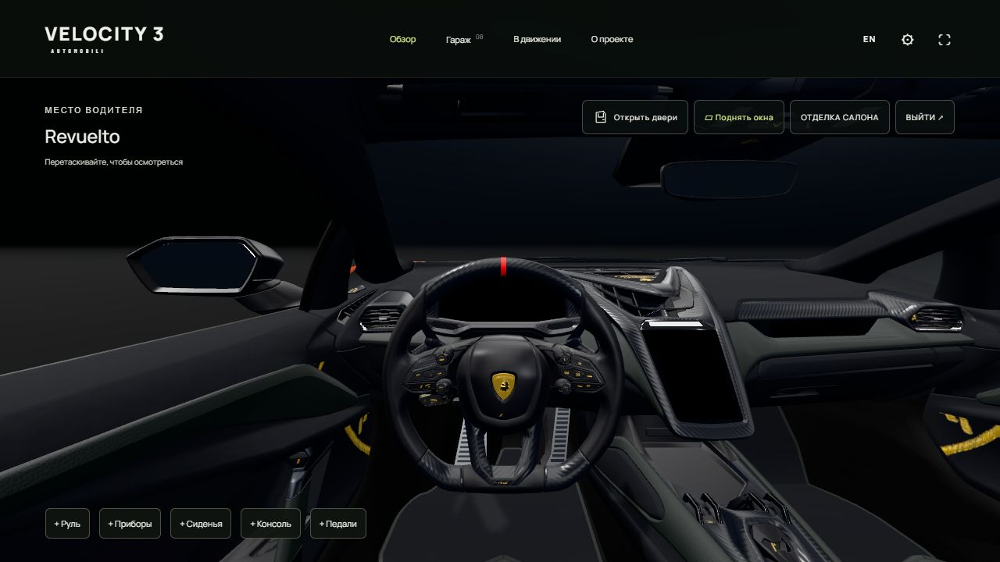

Неподвижные непрозрачные поверхности объединяются в адаптере для отрисовки: 270 видимых объектов вместо 560, без изменения 547 717 треугольников. Стёкла, двери и вращающиеся колёса остаются отдельными. Исходные узлы сохраняются для работы с моделью, но часть статических узлов скрыта в пользу объединённых поверхностей.

#### Окружение Revuelto и управление музыкой

Окружение Revuelto — небольшие одно-, двух- и трёхэтажные здания с четырьмя стенами и закрытыми крышами по обеим сторонам дороги. Используются архитектурные модули Modular Urban Apartments Facade, деревья Island Tree 01 и текстуры тротуаров Pavement 03 с Poly Haven (CC0). Этажность, ширина и оттенки отделки чередуются. Основания зданий отделены от дверей и окон; тротуар и покрытие дворов используют общую разметку UV в метрах и 4K цветовую текстуру. Позади зданий проходят невысокие границы дворов; дорожное покрытие и дворы выходят далеко за видимую границу сцены. Итальянская карта освещена дневным светом, с ясным небом без тумана; HDR Vatican Road используется только для освещения и отражений. Источники перечислены в public/models/CREDITS.md и public/textures/CREDITS.md. Ferrari сохраняет прежнюю дорогу.

Геометрия скачанных моделей оптимизирована Meshopt; текстуры включены внутрь GLB в WebP. Штукатурка фасадов использует исходные 4K карты цвета и нормалей; кремовый, терракотовый и оливковый оттенки сохраняют фотографическую фактуру. Бетонные блоки бордюра со швами примыкают к тротуару, без прежней металлической полосы. Фасады и деревья рисуются через InstancedMesh в пяти повторяемых секциях, без пересборки геометрии каждый кадр. Для повторной подготовки: `node tools/download-italian-environment.mjs`, затем `node tools/prepare-italian-environment.mjs`. Исходные большие файлы сохраняются за пределами Git в `../assets-research/italian-environment`.

Пять музыкальных тем находятся в верхней части настроек. Смена выполняется с плавным переходом; включение музыки и выбранная тема сохраняются. Звуки интерфейса подключены к кнопкам, ссылкам и переключателям, с защитой от двойного воспроизведения. Передние треугольные стёкла Revuelto и их рамки закреплены на кузове. Основные боковые стёкла и зеркала следуют за дверью; перед подъёмом дверь немного отходит наружу. Три исходных экранных поверхности салона получили читаемые дисплеи: живые скорость, обороты и передача, экран пассажира и центральная навигация. Фары дают короткую подсветку пола. Главная страница и поездка используют общий SceneLoading со сглаженным счётчиком и плавным исчезновением.

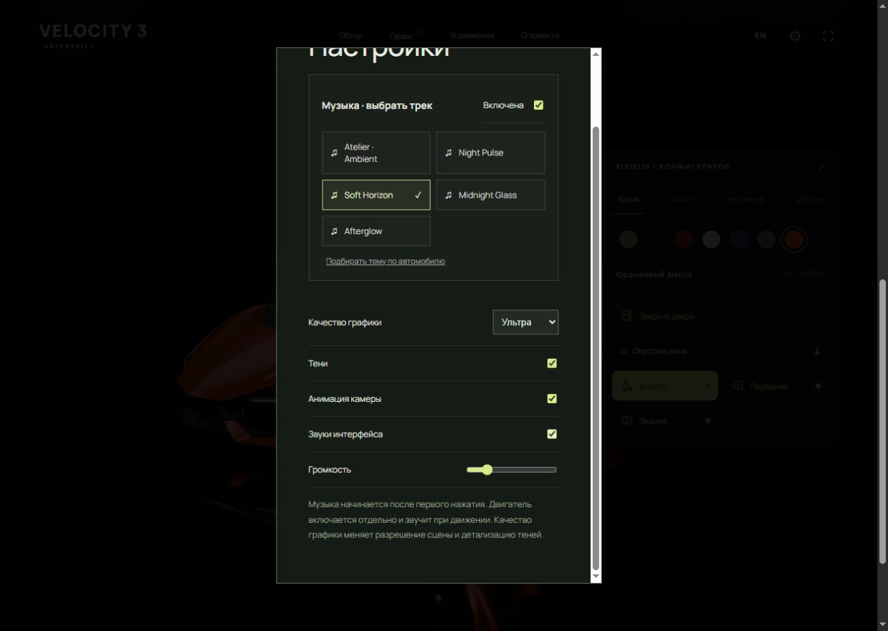

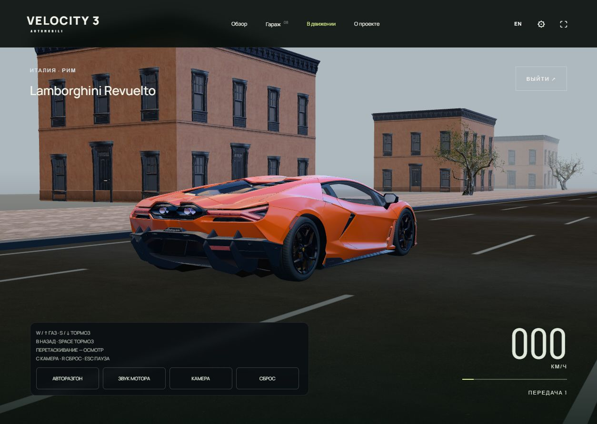

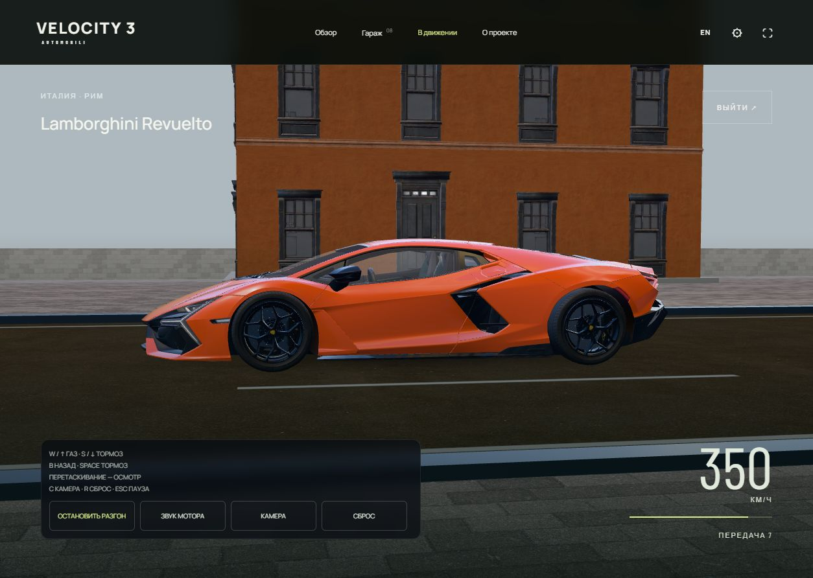

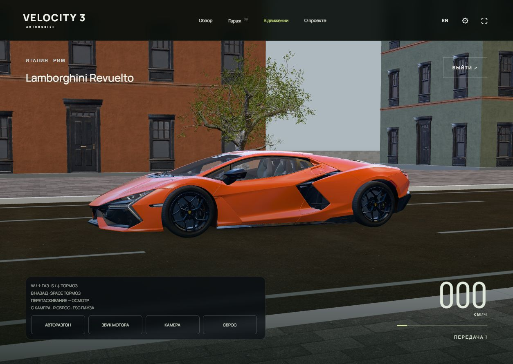

#### Проверка обновления 4 октября

Архитектурные модули перед объединением уплощаются в подготовительном скрипте: 18 примитивов вместо 63. Окна фасадов непрозрачные; прозрачность остаётся у автомобильных стёкол и вырезной листвы. Камера использует меньшую чувствительность и сглаживание, дневная карта — голубое небо и более умеренную экспозицию.

После публикации проверены загрузка главной страницы и поездки, открытие дверей, три экранные поверхности салона и вращение камеры при авторазгоне. В текущем браузере на Ultra получены два замера: 102 и 98 FPS, 9,2 и 9,6 мс отрисовки; результат зависит от устройства, разрешения и ракурса. Ошибок консоли при этой проверке нет. Отдельная проверка геометрии подтвердила, что матрицы передних треугольных стёкол и рамок не меняются при открытии дверей и опускании окон.

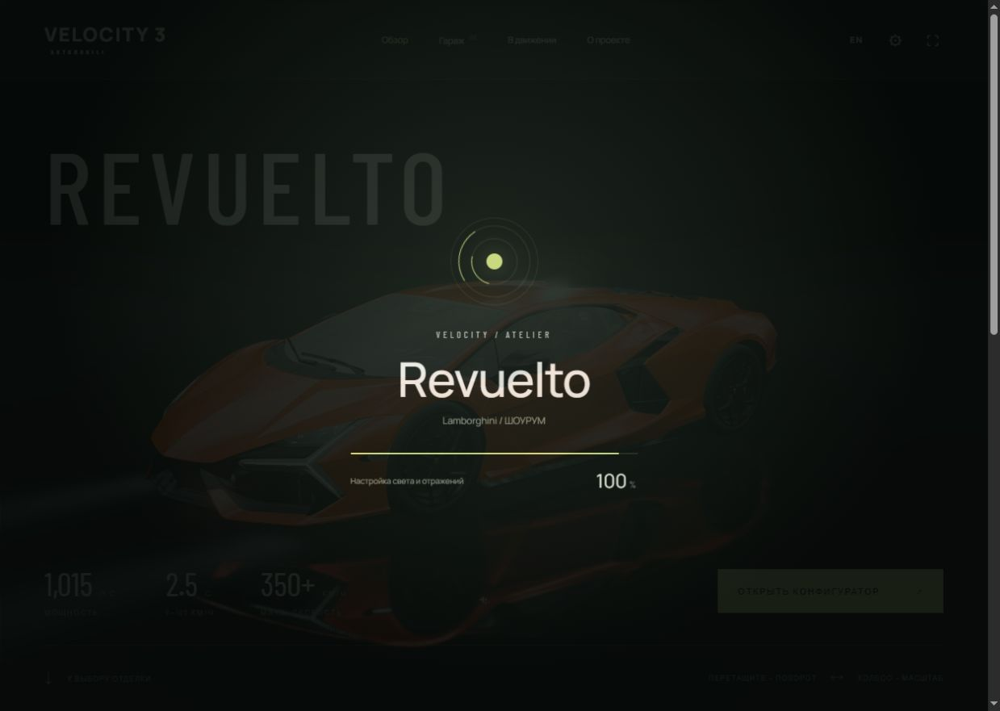

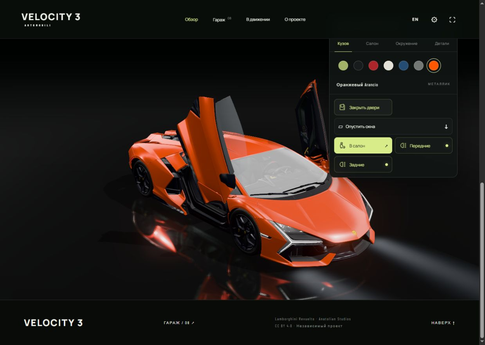

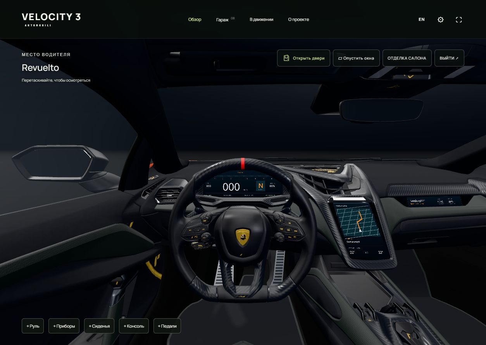

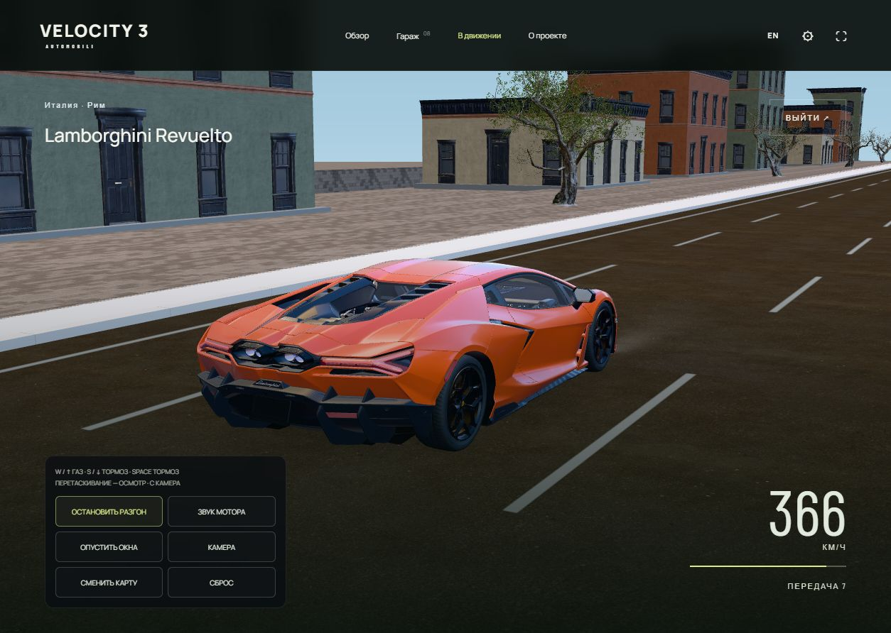


#### Стабильность дороги и экраны Revuelto

Покрытие тротуара отделено от бетонного основания на 21 мм (раньше 1 мм); polygon offset дополнительно защищает его от конфликта глубины. Основания домов опущены ниже пола модели. Улица повторяется восемью секциями на 640 м, дальняя граница камеры Италии — 260 м: секция возвращается в начало за пределами видимого диапазона, вместо появления в кадре без тумана.

Загрузка показывает целые проценты по одному, начиная с 1; сцена раскрывается только после достижения 100 и готовности ресурсов. Это счётчик этапов подготовки, а не процент скачанных байтов. Центральный экран салона показывает меню автомобиля вместо нарисованной карты; приборы используют центральный угловой тахометр и передачу, скорость слева и гибридную информацию справа. Ориентир: [официальная брошюра Revuelto](https://www.lamborghini.com/original/DAM/lamborghini/facelift_2019/model_detail/revuelto/2024/brochure/REVUELTO_DIGITAL_BROCHURE_EN_2024.pdf). Меню на поверхности 3D-экрана декоративное; управление сайтом остаётся в панели интерфейса.

Покрытие дворов разделено на две боковые поверхности, начиная за тротуаром (|z| ≥ 15 м). Под асфальтом больше нет второй текстурированной плоскости: это устраняет дальние пятна плитки на проезжей части.


После публикации проверен авторазгон до 370 км/ч с изменением ракурсов: прежние белые полосы плитки и перекрытие асфальта дворами не воспроизвелись. В интерфейсе при смене карты зафиксированы ранние 2% и 4%, затем завершение загрузки; проверено переключение Италия → ночь → Италия.

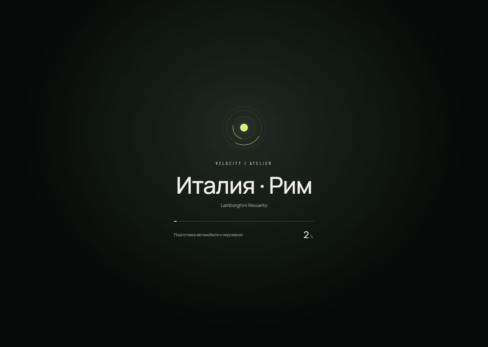

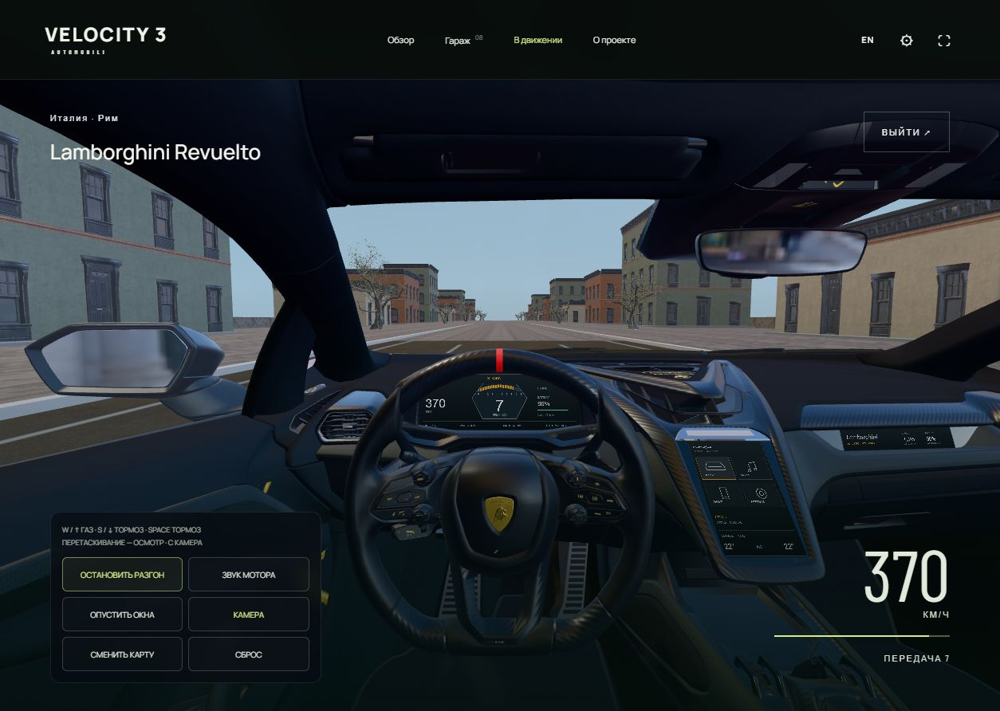

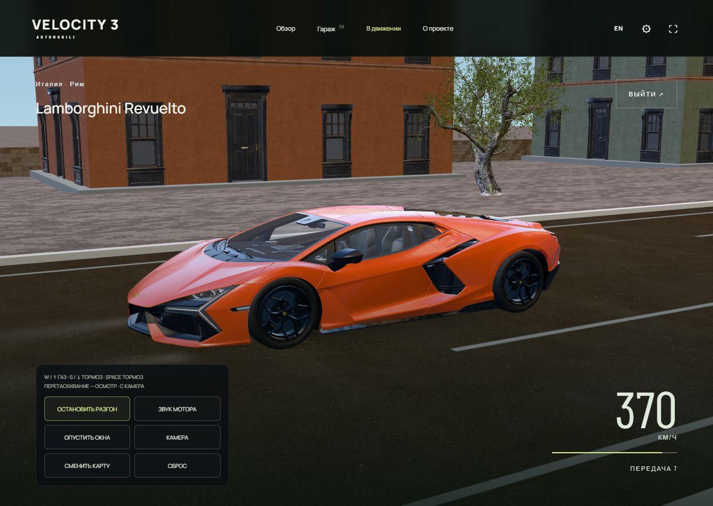


### Revuelto: screens, music, camera and Italian roofs (2026-10-04)

The native cluster surface now shows a circular 0–10 tachometer with red zone, moving needle, outlined central gear, speed, battery/fuel columns and chassis widget. The central screen uses a staggered hexagonal vehicle/media/settings launcher based on production Revuelto interior photographs and the [official HMI article](https://www.lamborghini.com/en-en/news/the-new-human-machine-interface-of-lamborghini-revuelto). The screen artwork is original; showroom screenshots supply the vehicle preview. The menu remains decorative.

The first and third original ambient tracks remain. Slots 2/4/5 now use full-length Neon, Machina and Chasing Daylight by Scott Buckley (CC BY 4.0 with visible Settings credits; see public/audio/CREDITS.md). They are distinct full mixes, not variations of the same short loop. Playback gain and the existing crossfade keep music quieter in Drive.

Cool and warm architectural galleries are selectable under Environment. Upholstery gains subtle grain while retaining imported maps, paint reflections are softened, and headlight floor spill is slightly brighter without extending its reach. Garage cards for the two completed cars now use screenshots of the actual model. The About navigation button is removed.

Italy uses instanced pitched tile roofs with scanned 2K PBR surfaces, gutters and chimneys; asphalt is less brown. Roofs share geometry and maps across street chunks. Existing depth separation and clear daylight remain intact.

Drive clamps its target pitch rather than only the displayed angle, preventing accumulated drag beyond the limit. Revuelto uses eight presentation gears with a brief torque cut on shifts; Ferrari retains seven. Revuelto audio is procedural V12 audio, not an authentic recording: it now responds to load, shifts, cabin/exterior views, airflow and braking. Ferrari's recorded audio remains unchanged.

Validation: npm run typecheck; npm run build; node tools/verify-drive.mjs (camera reversibility in three views, both speed limits, gear counts and braking). New MP3s decode at 44.1 kHz: Neon 259 s, Machina 291 s, Chasing Daylight 274 s.

Published browser checks: all three new music tracks play with decoded durations and no media errors; changing galleries works. Garage screenshots were recaptured from full viewport frames after detecting a crop error.

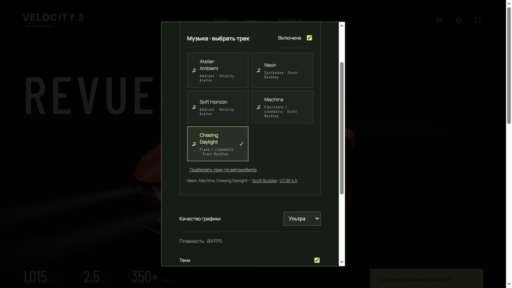

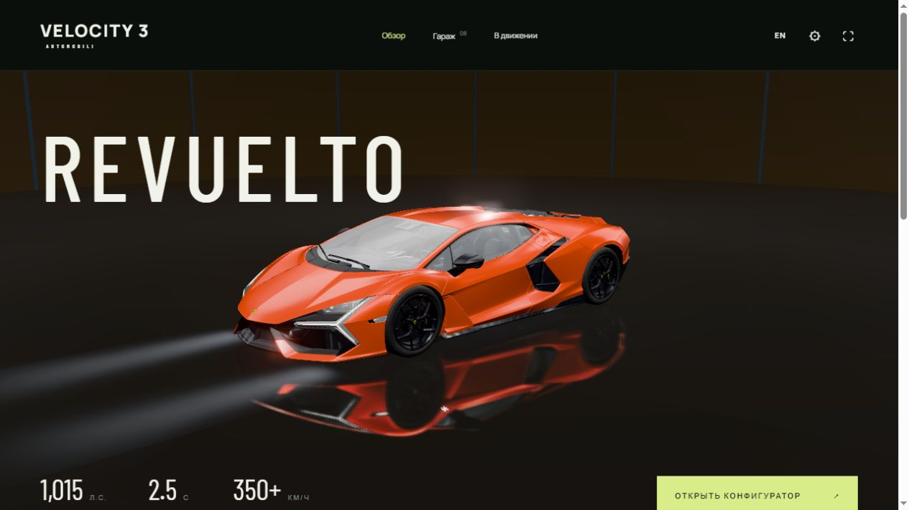

The published drive was checked at 370 km/h in exterior, cockpit and overhead views. Three downward camera drags followed by one upward drag raised the view without dead travel. No WebGL or media errors were reported during these checks. Italy's asphalt remained continuous in the inspected views. This is a presentation simulation, not a full vehicle physics model.

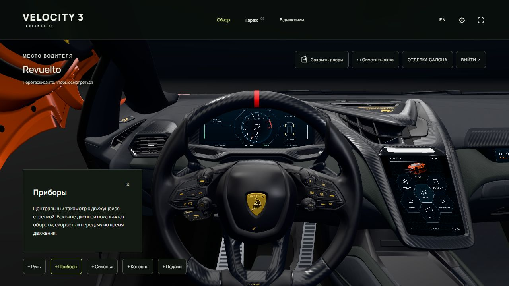

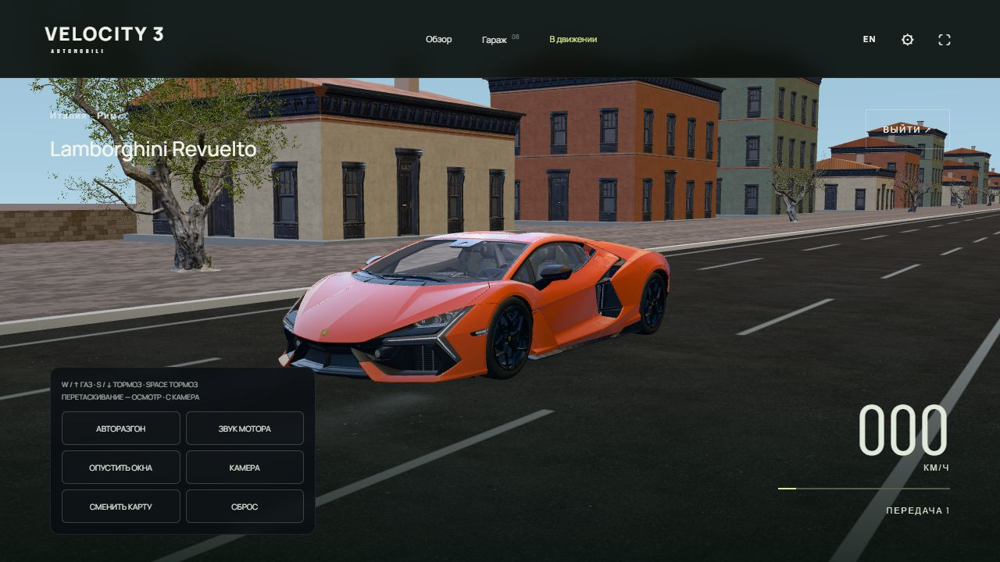

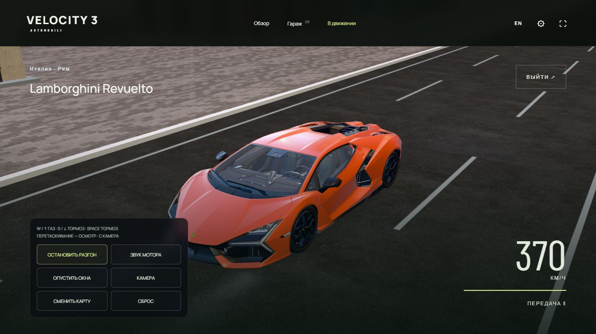

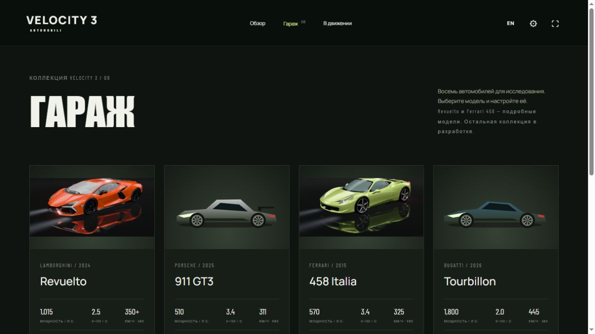


### Presentation, live garage and album (2026-10-04)

The showroom starts its introduction after `SceneLoading` finishes its fade. The car rolls 7.5 m onto the stage with rotating wheels, then the camera visits front, side, rear, overhead and wheel views before returning to OrbitControls. Dragging, scrolling, opening doors, entering the cabin, disabling camera animation or the Skip button interrupts the sequence and restores the car transform. Reduced-motion users bypass it. The sequence uses `app/three/showroomIntro.ts`; `node tools/verify-intro.mjs` verifies interruption and replay without displaced body/wheels.

`paintFinish.ts` adds a restrained viewing-angle pearl tint, thin-film iridescence and a polished clearcoat to the selected paint. Studio reflections drift slowly, retaining the selected color. Paint chips also show a gradient. Garage cards for the completed Revuelto and 458 now load the actual authored models with transparent WebGL canvases; they render on reveal, resize and pointer movement rather than continuously. Six future cars still have concept silhouettes.

Map thumbnails depict the actual map without a car or HUD. `public/images/maps/italy.webp` and `night.webp` are 720×400 renders made with `app/three/roadPreview.ts`. The picker serves these static WebP files, so opening it creates no additional WebGL scenes. Italy adds instanced terracotta planters, shrubs and downpipes. Service covers and drain grates are integrated into the asphalt shader to avoid depth conflicts. Kerb instances are prepared once and moved as a group rather than rebuilding 800 matrices every frame. Clear daylight and existing road-depth separation remain.

Eight music selections are available. Electric Dreams, Twilight Echo and Supernova by Scott Buckley join the previous five; full mixes, CC BY 4.0, artist credits in Settings and `public/audio/CREDITS.md`. These are licensed tracks, not copyright-free recordings.

The real Revuelto uses an eight-speed dual-clutch gearbox ([official brochure](https://www.lamborghini.com/sites/it-en/files/DAM/lamborghini/facelift_2019/model_detail/revuelto/2024/brochure/07_23/REVUELTO_DIGITAL_BROCHURE_EN_2024.pdf)); the scene now passes its gear count explicitly. Numerical ratios and acceleration remain a presentation simulation.

Road albedo scrolling uses an independent fractional texture phase. Markings and service-cover repeat on a shared 360 m interval, removing the previous asphalt phase jump every 624 m while keeping shader coordinates small. Shrubs have dense leaf grain rather than a flat green surface.


Published checks for this update: the cinematic tour was visible after loading and returned to the normal showroom; transparent Revuelto/458 garage previews load fully and fit their cards; the map picker shows actual Italy/night scenery. The three additional tracks were observed playing with advancing playback time and no media errors (291.60, 286.86, 247.58 s). Typecheck, production generation, camera/transmission checks and intro interruption/replay checks pass.

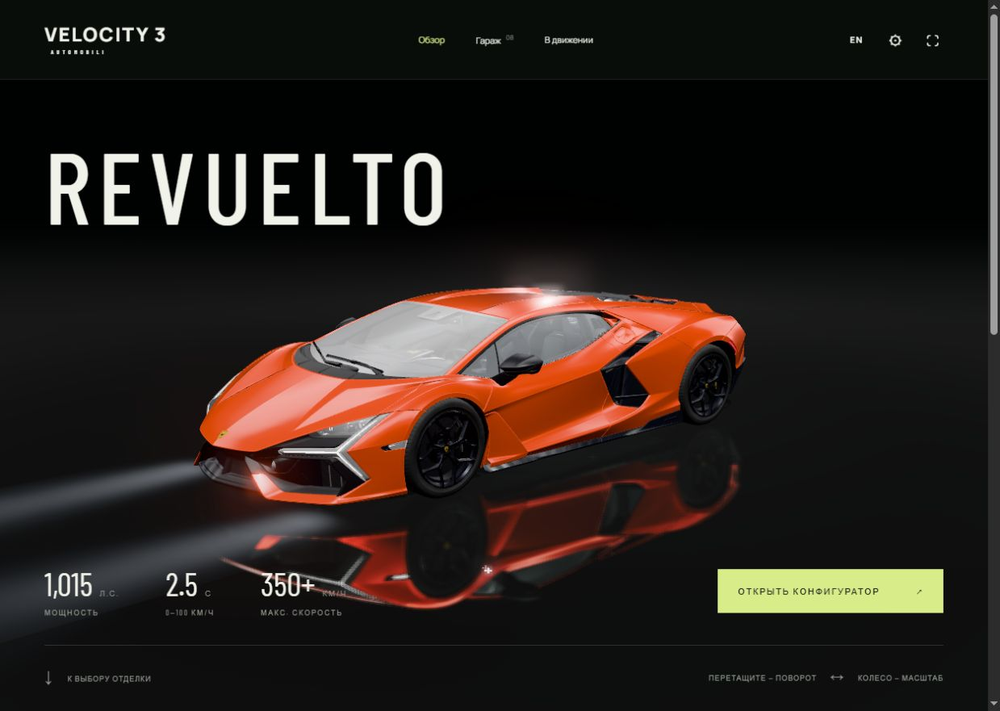

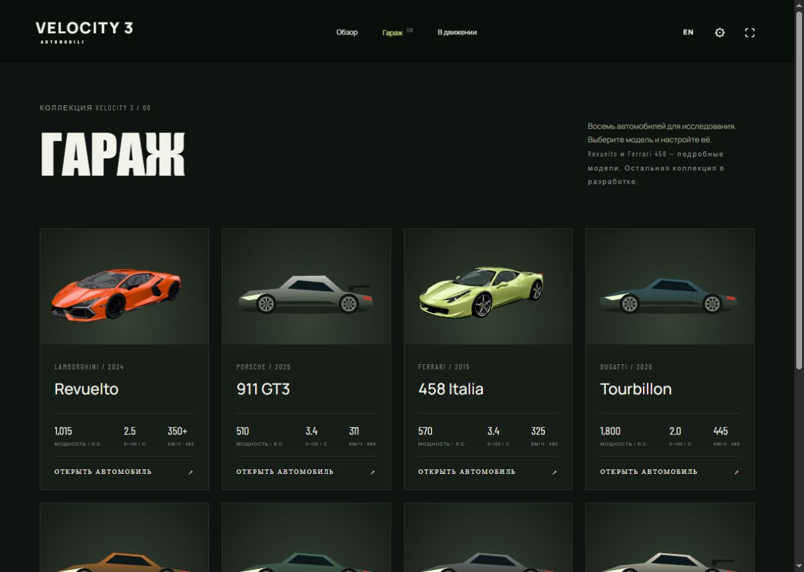

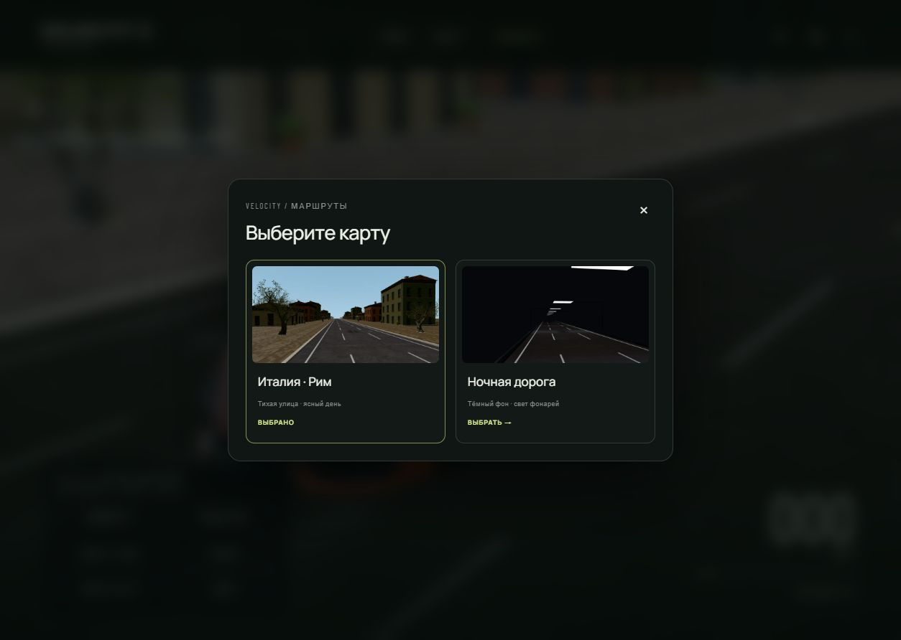

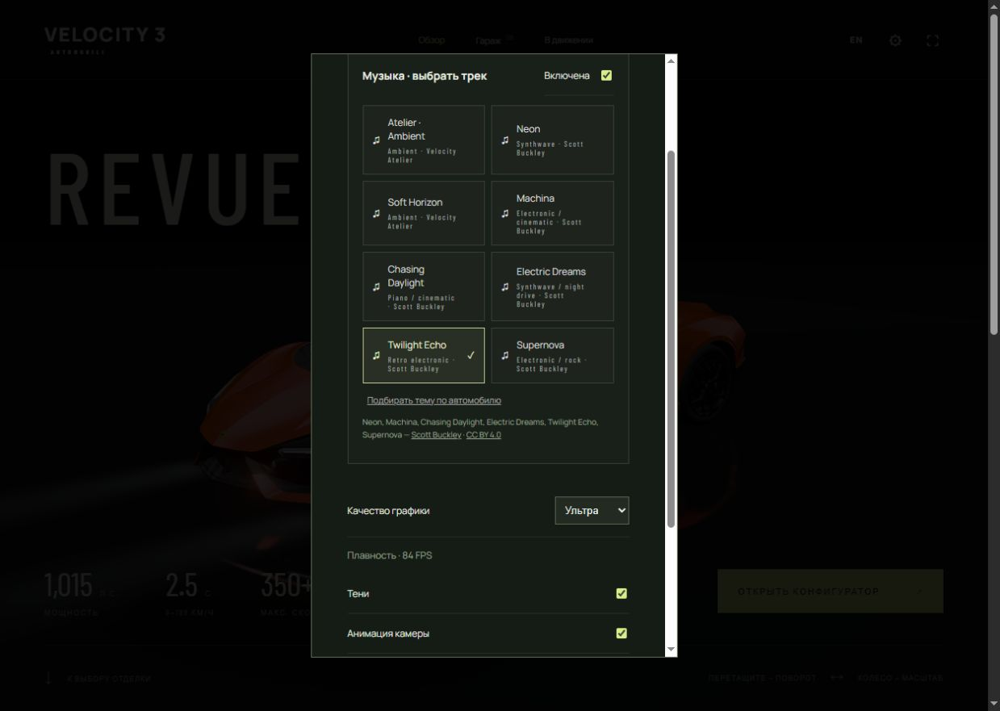

Final published road check: auto-acceleration reached the configured 370 km/h limit in gear 8 without console errors. Static map previews load from local 720×400 WebP assets. A live scene measurement on the test machine reported 123 FPS / 7.7 ms render time on Ultra at device pixel ratio 1; this is device- and view-dependent, not a cross-device benchmark.

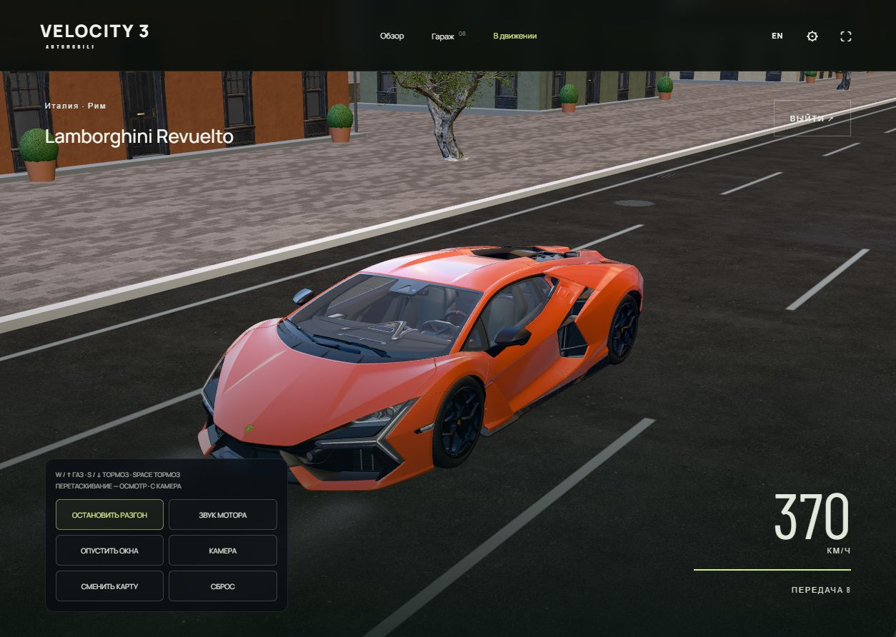


#### Showroom pacing and street cleanup
The introduction now rolls in over 4.2 seconds and uses longer eased camera passes. Canvas clicks and scroll no longer dismiss it; use the Skip intro button. Italy is a driving map only. Street planters were removed and rear paving replaced by plain ground. Paint has stronger neutral softbox reflections and an angle-dependent pearl coat. Map thumbnails are brighter. At driving speed, wheel display rotation is smoothly bounded to avoid temporal spoke aliasing; this presentation filter does not alter speed, gearing or road distance. Wheel pivots are derived from authored tyre geometry.

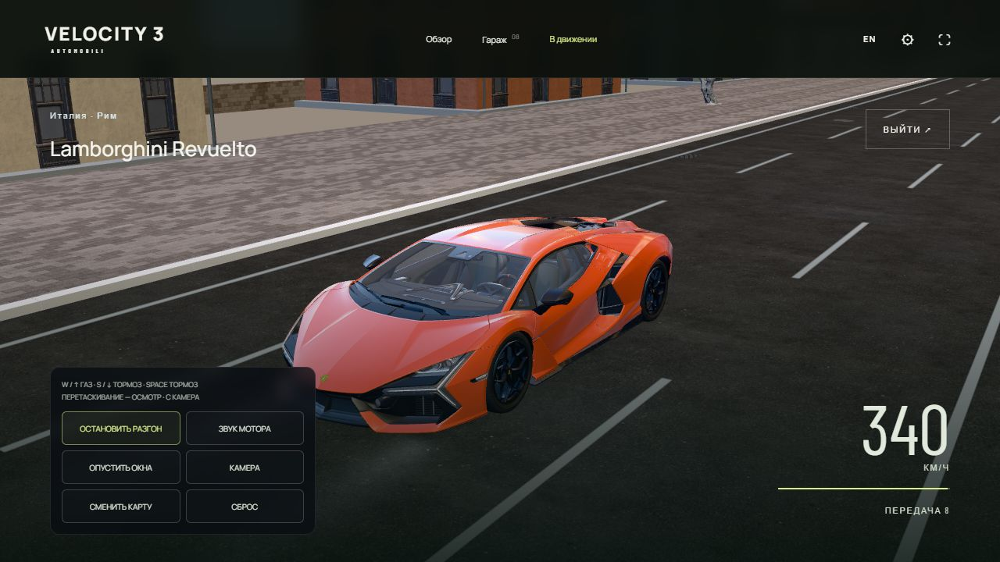


#### Editorial camera tour and clean studio
Intro: 3.4-second arrival, followed by independent close-up camera drifts with short fades masking viewpoint changes. Skip remains explicit. Studio background and lighting reset when returning to the showroom; saved paint and upholstery remain. Removed warm/cool backdrop ribs. The pearl shader now animates its viewing-angle tint alongside slowly moving environment reflections while motion is enabled. Removed the rear street boundary wall and desert-coloured paving; the distant ground blends into the sky without adding fog to the road or facades.

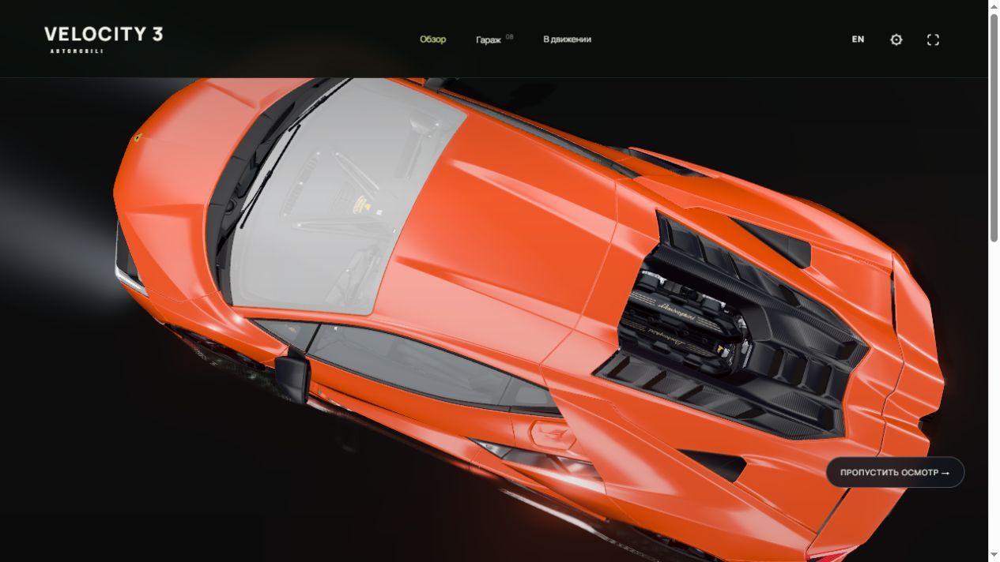


#### Последние изменения — пояснения к истории GitHub

Короткий код слева — идентификатор коммита Git, а не комментарий. Описания новых изменений пишем по-русски. Цвет кузова и обивка сохраняются, студия при входе возвращается к стандартному виду.

| Версия | Что изменено |
| --- | --- |
| f57f638 | Осмотр отдельными крупными планами с затемнением; чистая студия; убраны задняя стена и песочный фон |
| 5e1d646 | Исправлено отображение снимка проверки в README |
| 07ccaf0 | Добавлен снимок проверки дороги и описание выполненных изменений |
| 5076b95 | Плавный въезд и осмотр; убраны кусты; сглажено видимое вращение колёс; усилены отражения кузова |
| a76b847 | Записаны результаты проверки дороги и восьмой передачи |
| 5c36559 | Описаны осмотр, модели гаража и проверка музыкальных тем |
| 4856333 | Исправлен скачок текстуры асфальта при прокрутке дороги |
| e180538 | Настоящие рендеры карт вместо схематичных превью; исправлен размер моделей в гараже |

Текущее обновление: камера проходит дальше вдоль капота и боковин; мощение продолжается под зданиями до их заднего края; превью двух карт заново отрендерены в 1600×900 с более читаемым освещением. Параметр версии в адресах картинок предотвращает показ старых превью из браузерного кеша.


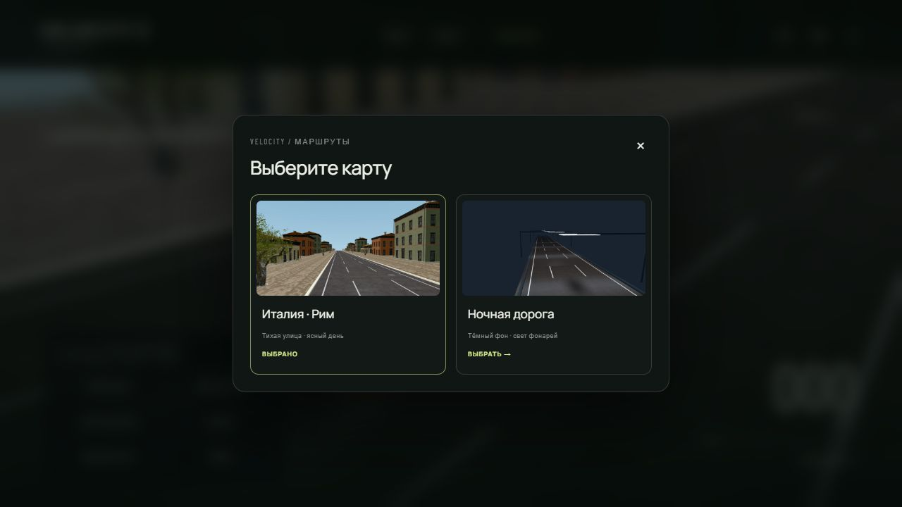

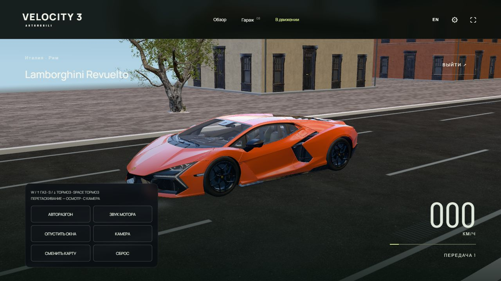


#### Раздельные двери, графика и свет

- Выбор карты теперь текстовый: Италия / Рим и Ночная дорога, без фотографий.
- Основание фасадов перекрывает нижний край здания на 3 см, убирая светлый зазор без совпадающих плоскостей.
- Левая и правая двери управляются отдельно на Revuelto и 458; салон сохраняет действие открытия/закрытия обеих.
- Цвет суппортов: пять готовых оттенков и произвольный цвет в разделе «Детали».
- Передние фары сохраняют короткие световые пятна. Задние фонари получили точечное освещение ближайших поверхностей и мягкий красный отсвет на полу. Это обычное освещение Three.js с дополнительным шейдерным пятном, не трассировка лучей.
- Отдельный переключатель вращения отражений окружения и света; остановка сохраняет текущую фазу. Необязательная сетка студии выключена по умолчанию.
- При первом входе появляется компактная панель графики; загрузка и осмотр продолжаются. Качество и предел FPS (30 / 60 / 120 / без ограничения) сохраняются локально. Панель всегда доступна через значок в шапке.
- `/legal` содержит авторов моделей, текстур, музыки и иконок, лицензии, ссылки на источники и описание изменений. Этот раздел не предотвращает техническое копирование сайта.

Проверено в браузере: раздельные двери обеих моделей, применение красных суппортов, задний отсвет, сетка и переключатель вращения, текстовый выбор карт (0 элементов img), целостный стык фасадов с двух ракурсов, страница лицензий. На тестовом компьютере измерены 30 и 60 FPS при соответствующем ограничении; результат зависит от устройства. Ошибок консоли в проверенных сценариях нет. `npm run typecheck`, `npm run build`, `node tools/verify-intro.mjs` и `node tools/verify-drive.mjs` проходят.

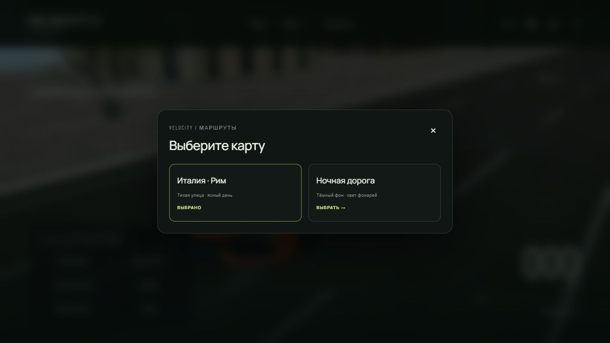

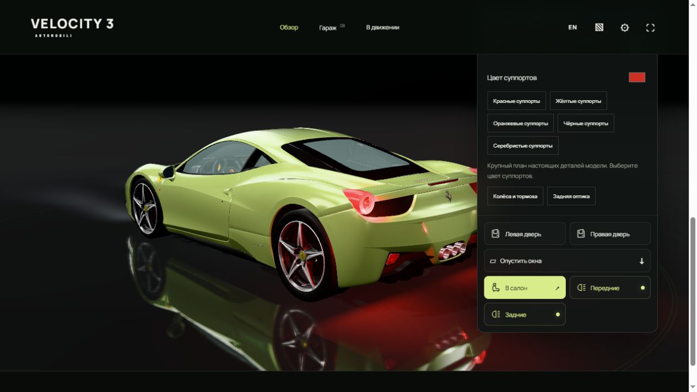

В итальянской улице смешаны две настоящие CC0-модели: Island Tree 01 и [Tree Small 02](https://polyhaven.com/a/tree_small_02) (Rico Cilliers). Второе дерево имеет другую крону и ветви; плотность, масштаб, поворот и оттенки посадок меняются по участкам. Деревья отбрасывают реальные тени. Сжатые исходные модели загружаются по одному разу и переиспользуются через InstancedMesh. Подготовка второго дерева: `node tools/prepare-canopy-tree.mjs`.

#### Облегчение поездки и исправление колёс Revuelto

Итальянская улица использует шесть повторяемых участков вместо восьми, 2–3 дерева на участок вместо 3–6. Тени и приём теней деревьями отключены. Дополнительные скатные крыши, дымоходы и их текстуры убраны; исходные закрытые фасады сохранены. Порядок одно-, двух- и трёхэтажных модулей меняется по участкам и сторонам. Рельеф плитки тротуара усилен без дополнительной геометрии.

Оси колёс Revuelto выставлены по центрам дисков; тормозные колодки, крепления и прочая смещённая тормозная арматура закреплены на кузове. Тест `node tools/verify-wheel-centres.mjs` загружает геометрию исходного GLB и проверяет все четыре колеса за полный оборот, а также неподвижность деталей тормозов. В студии добавлена кнопка всех дверей, дверь водителя открывается при выходе из салона. По умолчанию фары выключены; состояние переключателей совпадает со светом.

Тени в поездке ограничены внешними поверхностями кузова и колёс: карта основного света 1024 px обновляется до 20 раз/с, студия сохраняет прежние настройки. Убрано повторное обновление стёкол в каждом кадре при неподвижных окнах. Проверено в браузере: авторазгон до 370 км/ч, оба переключателя дверей и общая кнопка, выход из салона с открыванием водительской двери; ошибок консоли нет. В одном замере Ultra при pixelRatio 1: 6.2 ms render, 637 draw calls, 2.92 млн отрисованных треугольников; метрики зависят от ракурса, теневого кадра и устройства.

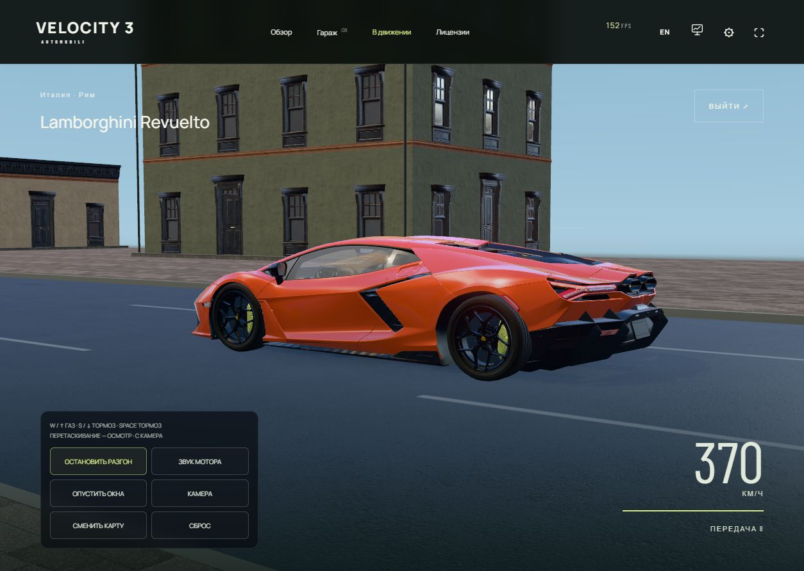

#### Автозакрывание дверей, студийный свет и редкая застройка

После выхода из салона водительская дверь закрывается по завершении движения камеры. В деталях остаётся произвольный цвет суппортов без текстовых пресетов. Добавлены три студийные схемы: каталожный, контурный и перламутровый свет; они меняют позицию, температуру и баланс существующих источников без добавления новых. Палитра окружения дополнена сланцем, полуночным синим и тёплым камнем.

Улица содержит 20 домов вместо 36: на каждой стороне участков остаются пустые места, одно- и двухдомные группы чередуются. Простые плоские крышки закрывают верх фасадов, наружные водосточные стойки убраны. Шины радиально выровнены относительно центров дисков; тест исходной геометрии теперь проверяет их положение за полный оборот. В браузере проверены автоматическое закрывание после выхода, новый контурный свет и разреженная застройка без ошибок консоли.

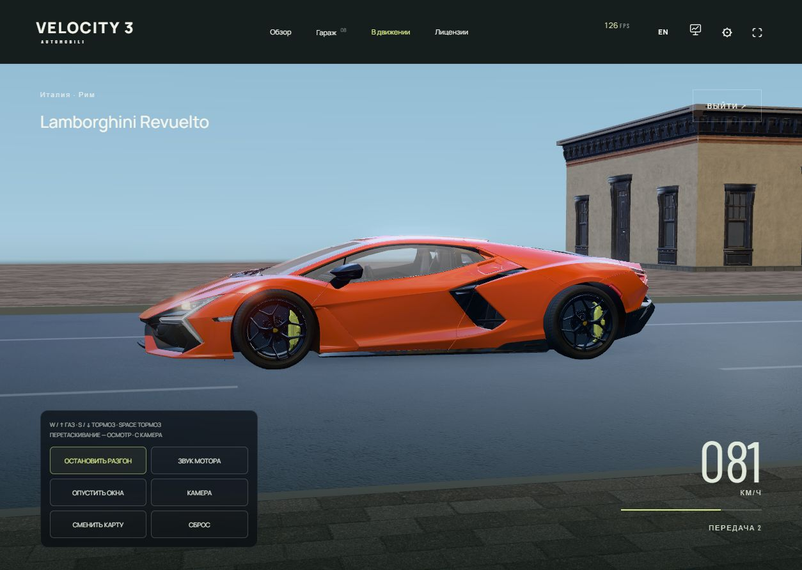

### Римская загородная дорога и контакт шин — 5 октября

Итальянская карта переработана: дома, крыши, основания и загрузка фасадов удалены. Цельная каменная проезжая часть использует CC0 Cobblestone Floor 08 (albedo 4K, normal/roughness 2K). Вдоль дороги расположены низкие кирпичные ограды, неровные посадки двух видов деревьев и холмы с текстурой Withered Grass. Дальние деревья используют те же реальные модели, без теней. Это художественная интерпретация окрестностей Рима, а не точная реконструкция улицы.

`app/three/tyreContact.ts` удерживает колёса на высоте покрытия, имитирует небольшую деформацию под нагрузкой, работу подвески и перенос веса при разгоне/торможении. Пружина интегрируется с подшагом до 1/120 с. Тормозные детали следуют перемещению ступицы и не вращаются вместе с шиной. Полноценный симулятор сцепления не используется.

Проверки: typecheck, production build, verify-light-road.mjs, verify-tyre-contact.mjs (30/60/144 FPS), verify-wheel-centres.mjs и verify-drive.mjs. Подготовка материалов: tools/prepare-roman-cobbles.mjs, tools/prepare-roman-grass.mjs.

### Асфальт, подвеска и асимметричный ландшафт — 5 октября

Последняя версия Италии использует единую асфальтовую проезжую часть: normal/roughness карты Asphalt 01, слабое старение, узкие каменные обочины. Камень больше не покрывает всю трассу. GPU-смещение поверхности и CPU-запросы колёс используют одинаковый периодический профиль высоты (`roadSurface.ts`), амплитуда неровностей не превышает 7 мм.

`tyreContact.ts` теперь измеряет именно шины, создаёт отдельные носители подвески, сохраняет вращение дисков вокруг собственных осей и крепит суппорты к носителям. Модель поддерживает четыре запроса высоты, ограничение хода 45 мм, пружины/демпферы, умеренный наклон кузова и перенос веса. A/D или стрелки меняют полосу в пределах дороги; прямолинейное ускорение/торможение ограничиваются доступным сцеплением с учётом боковой нагрузки. Расчётные параметры для визуальной модели: масса 1800 кг, жёсткость 42000 Н/м на колесо, демпфирование 4300 Н·с/м, высота центра тяжести 0.43 м. Это настроенная визуальная физика, а не сертифицированная симуляция конкретного автомобиля.

Окружение: зелёное покрытие Leafy Grass, небольшие нерегулярные холмы, асимметричные рощи крупных деревьев, сосны, кусты, травяные группы, камни и небольшие фрагменты кладки/колонн. Дальние рощи используют упрощённые геометрии; полные и упрощённые модели делят текстуры. Растительность без динамических теней, повторяющиеся элементы объединены instancing. Фасады и городской силуэт не загружаются.

Проверено: typecheck, production build, вращение всех четырёх колёс на реальной Revuelto, контакт реальной геометрии шин (погрешность до 4 мм), подвеска при 30/60/144 FPS, периодичность дороги/рельефа, асимметрия рощ, повторное переключение карт. Источники материалов и моделей приведены в `/legal` и CREDITS.md.


Доступная карта: тоннель. Мокрая дорога и скалистое побережье отключены по результатам просмотра; их ресурсы не загружаются.


#### Desert road
Local preview: /drive/revuelto?map=desert. Straight 8.6 m road with sparse sand drifts. Blender master: ../blender/desert/Desert-road.blend; original master remains untouched. Prepare with ../blender/prepare-desert-road.py; compress with tools/compress-desert-road.mjs. Attribution: public/models/desert/SOURCES.md.

Desert runtime refinement (2026-10-06): the road stays level. Roadside shrubs are thinned deterministically from 506 to 175 per source segment; Opuntia placements are retained. Heavy plants use near/far shared mesh assets generated by `tools/desert-plant-lods.mjs`, with 40 m spatial clusters for culling and LOD switching. Original meshes and 4K texture dimensions are retained in the source assets. `hillOffset` changes shoulder relief asymmetrically and applies the same vertical displacement to plant and stone placements, with no change to the road height.

Desert visibility refinement: adjust shared plant materials once per material (not once per mesh), use lighter neutral foliage tint and sky/ground fill. Add one existing source shrub in otherwise empty 22 x 25 m cells near the route, keeping other cells sparse. The source master remains unchanged.

Compact desert (2026-10-06): crop the source terrain to a 70 m strip, compress outer scenery width 2x around the unchanged 8.6 m road corridor, and lower hills 25%. Keep three repeated segments. Remove the distant sand plane entirely; overlapping textured shoulder ridges enclose the route. Scatter positions follow the same width/height transform, and props beyond the cropped corridor are omitted. Atmosphere fades between 65 and 112 m. The gradient sky uses linear RGB to match the fog after tone mapping. Sand drifts use different edge widths and offset noise patterns on either side of the road. Asphalt uses diffuse, normal and roughness maps. Desert-only sun/fill lighting is adjusted; tunnel and showroom lighting remain separate.

Plant presentation: use original geometry close to the camera, shared medium meshes at 20 m and far meshes at 42 m, with LOD hysteresis and distance culling. Tyre presentation uses a fixed visual spin-rate cap independent of frame duration; chassis load transfer and suspension targets are damped. Run `node tools/check-tyre-contact.mjs` to check flat-road contact and suspension continuity at 30, 60 and 120 FPS.

Further compact pass: the source corridor is now 48 m wide before compression; scenery beyond the 8.6 m road is compressed by 0.25. The enclosing shoulders extend only 8 m per side after compression, for a total scene width of about 35 m. Repeated sections are 80 m long instead of 160 m. `desertSurface.ts` resamples the original relief onto a complete 0.5 m source grid, rather than dropping triangles across a crop boundary. Segment border heights match exactly. Planar sand UVs retain the original 2.5 m material scale without sampling distortions. Surface geometry is 61,440 triangles per section; 4K PBR textures are retained. Stones are further thinned and given a dark matte finish. Validate source coverage and periodic borders with `node tools/check-desert-surface.mjs`.

Shoulder edges use the same 321 rows as the main relief, so every shared boundary vertex matches. Plant and stone positions sample the rebuilt height field; atmospheric fade ends at 75 m, before the nearest repeated-segment endpoint (80 m).

Desert presentation refinement: independent periodic height functions on each roadside, with different shoulder crest heights and frequencies. Reposition one quarter of the selected shrubs into irregular roadside groups without adding instances, and resample their ground height. Ground beneath the asphalt is lowered by 6 cm to avoid coplanar flickering. Original sand textures use trilinear mip filtering, anisotropy 12, stronger normal detail and matte roughness. Terrain casts and receives sun shadows; plant shadows remain disabled. The desert sun has a ground-level target and a wider shadow frustum, with warm direct light and restrained sky fill. Exterior desert cameras are 8% closer; other maps keep their existing distances.

Match shoulder boundary normals to the core terrain for continuous lighting across the joint. Desert exterior FOV stays at 55 degrees on initial load, camera changes and map changes, avoiding a sudden zoom when cycling views.

Desert shadow intensity is restrained to 0.35, with a 48 m coverage width and normal bias to reduce self-shadow artifacts. High/Ultra use a 2048 shadow map; shadows refresh at most every 16 ms during movement.

Daylight composition pass: reshape the sampled relief before ground placement. One roadside uses low dunes, the other uses separate periodic height peaks; both remain closed and continuous. Lower desert exterior camera elevations to 0.28 radians (inspection view: 0.5). Use warm side sunlight with cooler sky fill. Sand has subtle periodic macro-colour variation that matches both shoulder joins and repeated section borders. Dry foliage is tinted and gently desaturated in its material shader. Tall yucca, poppy and ocotillo assets are omitted from this driving map; source files remain intact.

Vegetation scatter: redistribute existing shrubs, Opuntia and beavertail across both full slopes, with most placements outside the original terrain strip. Deterministic per-prototype seeds vary width, longitudinal position, rotation and scale (0.78–1.21). The same shoulder height function builds the terrain and places plants on it. Instance counts stay unchanged; the route remains clear.

Scatter retries candidates to keep roughly 2.2 m between plant centres, avoiding dense overlapping clumps while retaining irregular placement.

Terrain camera guard: sample the rebuilt height field and shoulder profile along the car-to-camera sightline. Raise exterior camera clearance when a dune would obstruct it; smooth the descent afterward. This applies to the desert only. Sparse 8-row cells receive one lightweight existing creosote where no plant is within 4 m. Leaf alpha cutoff is reduced to 0.18, and the medium bush geometry is retained at distant LOD rather than using sparse scan remnants. Sand macro colours shift slightly toward warm terracotta.

Desert material refinement: periodic mineral colour variation and derivative-faded fine sand grain, stronger existing normal detail, lighter dry foliage with a small texture-masked ambient lift. Independent hill harmonics preserve segment seams and terrain camera sampling. Side sun and brighter hemisphere fill improve terrain depth without adding objects or texture downloads. Changes apply only to the desert drive scene.

Desert roadside pass: asphalt edge blends fully into the terrain's shared sand texture with irregular drifts; shallow periodic washes and variable flat shoulders break up ridge silhouettes. Existing shrubs and cacti receive a small dry-colour lift, and their lowest source-model vertex is seated into the sampled terrain by 3.5 cm. No additional plant instances or textures.

Desert depth and contact pass: haze now fades from 55 to 105 m to retain distant hill silhouettes; restrained periodic hollows preserve seamless terrain repeats and camera height sampling. Sand macro contrast reduced on both terrain and asphalt dust blend. Foliage has an olive minimum light floor to avoid black silhouettes. Four shared radial contact-shadow patches follow tyre ground probes (no extra shadow render pass); their geometry/material/texture are disposed with the map.

Desert natural-material pass: a small derivative-filtered wind ripple perturbs sand normals at close range, with subtle roughness variation. Road roughness varies under side lighting. Foliage uses a gentle additive ambient lift rather than a hard minimum brightness so light/shade and leaf texture remain visible. Independent extra crest harmonics diversify distant silhouettes while retaining periodic borders. No extra objects or downloaded textures.

Desert grounding and sand-scale fix: each plant LOD seats sampled transformed base vertices into the height field after scale/rotation, replacing the origin-offset approximation. Sand diffuse uses world-scale triplanar projection, with terrain movement subtracted to keep textures attached while driving. Terrain and shoulders share scale, elevation blends compact darker roadside sand into dry upper slopes; wind ripples appear only in sparse patches. Added shallow asymmetric relief while preserving the straight road.

Sparse desert composition: all shrub, tumbleweed, grass and flower prototypes are skipped before model loading. Only up to five Opuntia and two beavertail plants per 80 m section remain, with one third of the previous stones. Existing grounding and world-scale sand materials remain; gentle windward terrain relief adds shape without extra objects.

Desert sand material replacement: Poly Haven Sand 01 CC0 (Rob Tuytel), local 4K diffuse and 2K normal/roughness maps, warm neutral tint and shared terrain/road dust finish. Previous embedded sand maps remain in the source GLB but are no longer assigned to the terrain material. Stone instances are filtered by transformed bounding-box size: maximum dimension 25 cm; large rocks omitted. Attribution added to legal page and source records.

Desert vegetation removed entirely: all non-stone prototypes, including Opuntia and beavertail cactus, are skipped before loading. Only stones no larger than 25 cm remain. Sand material unchanged pending user selection.

Salt-flat reference rebuild: the daylight driving scene now uses a new flat salt-crust surface, a straight PBR asphalt highway with yellow dashes, and two distant asymmetric mountain rings. No desert GLB, vegetation or stones are loaded. The supplied second photograph is a composition reference, not a downloaded model or a claim of an exact photographic match. Tunnel unchanged.

Salt-flat quality pass: ridged mountain terrain with PBR rock detail, granular salt-crust normal map and mineral patches, raised irregular gravel shoulders, and an angle-based sky dome. Shared road textures and reusable marking transforms avoid per-frame allocations. Local preview restarted on port 3010.
Verified locally after restart: generated build and typecheck pass; visible-browser auto acceleration reached 237 km/h, reset returned to zero; no browser render errors were reported. Screenshot: docs/screenshots/salt-flat-quality-preview.png. This remains a reference-inspired browser scene, not a photogrammetric replica.

Open speed-test location: removed the encircling mountain rings. Two compact, PBR-textured terrain layers now exist only in front of the vehicle (-X), with an open central valley aligned to the straight road. The level asphalt corridor extends 4 km and scrolls continuously; charcoal albedo remap, original normal/roughness maps, distance-filtered aggregate micro-normal detail, and longer gravel verges. No side/rear mountains, water, buildings or vegetation.
Browser validation: open-road auto acceleration reached 370 km/h; cockpit and side cameras rendered without console errors. Side camera confirmed an unobstructed landscape. Distant terrain is confined to X <= -1150 m; road height remains constant at 8.287 m. Final daylight marking instances use a single group translation rather than per-frame matrix uploads.

### Blender salt-flat location
Source: tools/generated/saltflat/saltflat-speed-test.blend. Rebuild with Blender 5.2 using tools/build-saltflat-blender.py, then encode the baked PNG to the runtime WebP with sharp quality 94 and run npm run build. Geometry exports to public/models/saltflat. Runtime module: app/three/blenderSaltFlatRoad.ts. Sources and licenses: public/models/saltflat/SOURCES.md. The map uses shared 160 m tiles and near/far geometry, rather than storing an enormous landscape.

Salt-flat composition: the distant mountain GLB is translated 1.8 km beyond its original location and remains outside the moving tile group. Driving never approaches it. Salt banks now narrow towards the water at 9–14 m from road centre; three animated normal scales add water ripples without additional simulation geometry.
